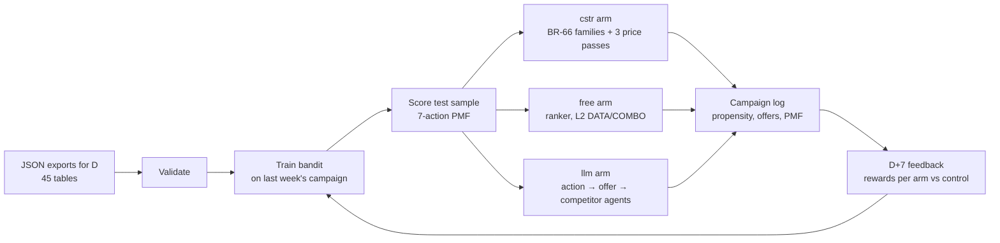
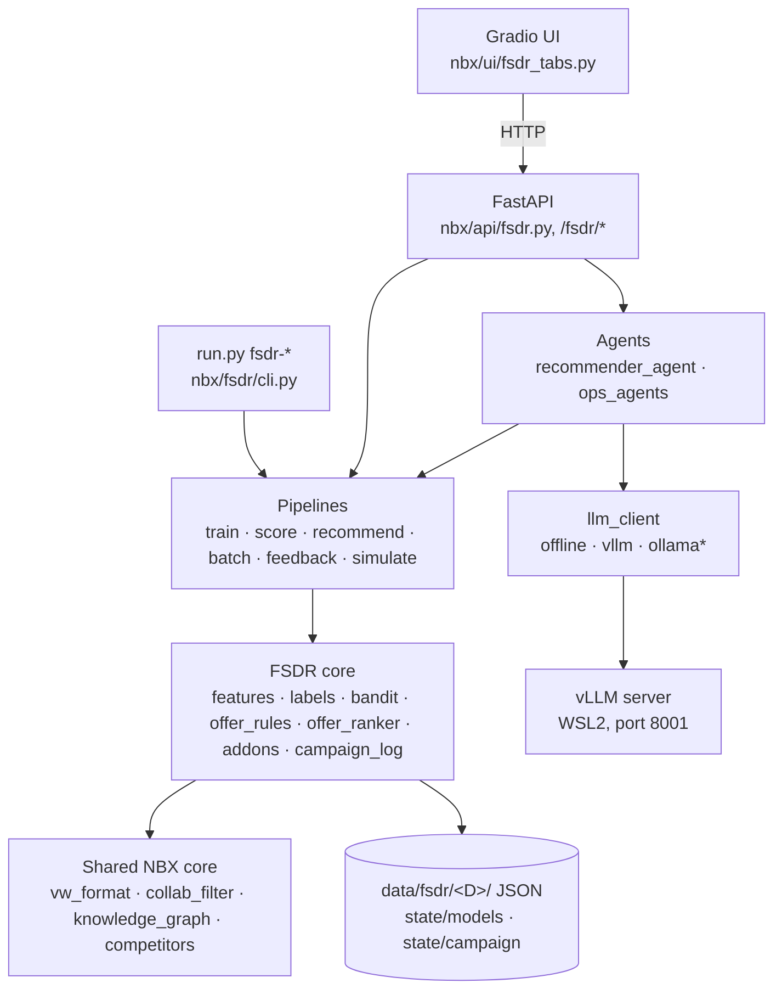
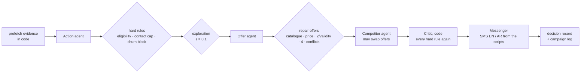

# FSDR Recommender — Complete Handbook

> **V1.0 edition.** This handbook describes the V0 engine, which V1.0 keeps in full. Two differences apply
> everywhere: install and run with **uv** (`uv sync`, then `uv run python run.py <command>` wherever this
> handbook says `python run.py <command>`), and the NBX demo modules, Ollama and the vector stores are gone.
> What V1.0 changes in the engine (offer arbitration, promotion, uplift, consent, fairness, PII, features, report,
> campaign log, registry lock, CI / Docker) is in [IMPROVEMENTS_V1.0.md](IMPROVEMENTS_V1.0.md), each change with
> its switch back to the V0 behaviour.

The FSDR recommender decides, every week and for every prepaid line in the test sample:
1. **the next best action** (retain, upsell data, cross-sell voice, …);
2. **the best offers for that action** (BTL bundles priced around the customer's spend);
3. **the add-ons** (roaming, international) where they fit.

It does this in four arms (control, free, constraint, LLM), logs what it sent, measures what came back, and learns
from it the following week.

This handbook covers everything. The steps, every business rule (BR-01 … BR-86), the agents, the data contract,
and how to run the app, the API and the vLLM server all live in this one file. The two other documents go deeper on
two topics:
- [FSDR_AGENTIC_RECOMMENDER.md](FSDR_AGENTIC_RECOMMENDER.md): the LLM agents, field by field;
- [GPU_SETUP.md](GPU_SETUP.md): GPU servers.

| Read this if you want to… | Go to |
|---|---|
| run the app now | [§3 Install](#3-install-and-check) → [§4 Run](#4-run-the-app-the-api-and-vllm) |
| understand the weekly cycle | [§7 The weekly cycle](#7-the-weekly-cycle-step-by-step) |
| check a business rule | [§16 Business rules](#16-business-rules-br-01--br-86) |
| plug in real data | [§5.7 Real data](#57-switching-to-real-data) |
| call the API | [§19 API reference](#19-api-reference) |
| fix a problem | [§23 Troubleshooting](#23-troubleshooting) |

---

## Contents

1. [What FSDR does](#1-what-fsdr-does)
2. [Architecture](#2-architecture)
3. [Install and check](#3-install-and-check)
4. [Run the app, the API and vLLM](#4-run-the-app-the-api-and-vllm)
5. [The data contract](#5-the-data-contract)
6. [Calendar and time windows](#6-calendar-and-time-windows)
7. [The weekly cycle, step by step](#7-the-weekly-cycle-step-by-step)
8. [The NBA model (best action)](#8-the-nba-model-best-action)
9. [Offer selection (NBO)](#9-offer-selection-nbo)
10. [Batch flow and add-ons](#10-batch-flow-and-add-ons)
11. [The agentic recommender (llm arm)](#11-the-agentic-recommender-llm-arm)
12. [Competitor intelligence](#12-competitor-intelligence)
13. [Operations agents](#13-operations-agents)
14. [Campaign log, feedback and reports](#14-campaign-log-feedback-and-reports)
15. [Closed-loop simulation](#15-closed-loop-simulation)
16. [Business rules BR-01 … BR-86](#16-business-rules-br-01--br-86)
17. [Configuration reference](#17-configuration-reference)
18. [CLI reference](#18-cli-reference)
19. [API reference](#19-api-reference)
20. [Web UI](#20-web-ui)
21. [Output files](#21-output-files)
22. [Testing](#22-testing)
23. [Troubleshooting](#23-troubleshooting)
24. [Differences from production](#24-differences-from-production)
25. [Data privacy and security](#25-data-privacy-and-security)
26. [Glossary](#26-glossary)

---

## 1. What FSDR does

Every week, on run date **D**, FSDR:

1. **reads** 45 JSON tables exported for D (or generates realistic dummy ones);
2. **validates** them against the data contract;
3. **trains** a contextual bandit (Vowpal Wabbit) on last week's campaign: what was sent and who took a BTL;
4. **scores** the test sample: one action per line, with the probability of each of the 7 actions;
5. **recommends offers** per arm:

   | Arm | How it decides |
   |---|---|
   | `cg` | control: no contact |
   | `free` | the ranker only (the NBA action is not used) |
   | `cstr` | the NBA action restricts the offer families |
   | `llm` | three LLM agents decide (action, offers, competitor check), under hard rules enforced in code |
6. **logs** every decision with its propensity (the probability of the action actually sent);
7. **measures** at D+7 what each line bought, per arm, against the control;
8. **learns** from it the following week (logged-propensity labels).



The operator is called **FSDR** everywhere (`OPERATOR_NAME`). Competitors are labels **COMPETITOR_A** /
**COMPETITOR_B**. No real company name appears in the code, the data or the docs.

---

## 2. Architecture



\* Ollama is switched off (`OLLAMA_ENABLED=0`); see [§4.6](#46-ollama-switched-off).

**The UI has no business logic.** Every button calls an API endpoint. The CLI and the API call the same pipeline
functions.

| Module (`nbx/fsdr/`) | Role |
|---|---|
| `config.py` | Every constant and threshold, with its BR number in a comment |
| `calendar.py` | D → T anchor and every time window (BR §4) |
| `schemas.py` | The 45 tables: fields, raw types, keys, cross-table relations; JSON Schema export |
| `datasource.py` | `JsonSource` (a run folder, `.json` or `.jsonl`), `SyntheticSource` (in memory) |
| `validation.py` | Validation report (blocking / warning / info) |
| `features.py` | Eligible base, model scores, usage, subscriptions → 48 production features + 3 last-campaign features |
| `labels.py` | Targeting → action, reward, propensity; or labels from the campaign log |
| `bandit.py`, `registry.py` | Vowpal Wabbit training, scoring, save / load, champion / challenger registry |
| `offer_rules.py`, `offer_ranker.py` | ARPU anchors, BR-66 families, 3-pass price bands, conflicts; BPR ranker |
| `addons.py` | Roaming / international add-on engine (batch flow) |
| `campaign_log.py` | Append-only campaign log, rewards, last-campaign features |
| `pipelines/` | `train`, `score`, `recommend`, `batch`, `feedback`, `simulate` (each returns a JSON report) |
| `agents/` | `recommender_agent` (3 agents of the llm arm), `ops_agents` (data / training / scoring / monitor), `tools` |
| `synth/` | Hidden customer world, dummy-data generator, scenarios |

| Shared module (`nbx/core/`, `nbx/agents/`, `nbx/llms/`) | Used by FSDR for |
|---|---|
| `core/vw_format.py` | The VW text format **and** the learning / sampling loops, shared with the NBX demo bandit |
| `core/collab_filter.py` | BPR model (`implicit`) behind the offer ranker |
| `core/knowledge_graph.py` | Cohort graph (`cohort_offers` tool), built from the FSDR run's own data |
| `core/competitors.py` | Competitor snapshot and plan comparison |
| `agents/agentic/react.py` | The ReAct loop of every agent (one JSON per step, step cap, required evidence) |
| `llms/llm_client.py` | One client for the offline, vLLM and Ollama backends |

---

## 3. Install and check

**Requirements:** Python **3.10+** (verified on 3.12, Windows 11), pip, and about 3 GB of disk for the packages.
vLLM needs an NVIDIA GPU; see [§4.4](#44-vllm-the-llm-for-the-agents).

```powershell
cd nbx-python-upgrade
python -m venv .venv
.venv\Scripts\Activate.ps1                 # macOS / Linux: source .venv/bin/activate
pip install -r requirements-dev.txt        # app + tests
copy .env.example .env                     # then edit .env (see §17)
python run.py check                        # Python, packages, data files, search index, LLM backend
python run.py setup                        # build the search indexes once (about 1 min)
```

| File | Content |
|---|---|
| `requirements.txt` | Runtime: FastAPI, Uvicorn, Gradio 5, httpx, pydantic 2, pandas 2, numpy, scipy, networkx, implicit, vowpalwabbit 9, sentence-transformers, chromadb, faiss-cpu, beautifulsoup4, python-dotenv, python-multipart. Every package has a version range |
| `requirements-dev.txt` | `requirements.txt` + pytest, pytest-asyncio, jsonschema (schema tests), pyarrow (import-order test) |
| `requirements-vectorstores.txt` | Optional vector stores: Qdrant, LanceDB, Milvus Lite |
| `vllm/install_wsl.sh` | vLLM in WSL2 (its own venv, see [§4.4](#44-vllm-the-llm-for-the-agents)) |

**Optional packages:**
- **LightFM** does not install on Python 3.12, so the default ranker is BPR.
- **Qdrant, LanceDB and Milvus** are optional vector stores.

The app works without them.

---

## 4. Run the app, the API and vLLM

### 4.1 Everything at once

```powershell
python run.py vllm-serve      # window 1: the LLM server (only if LLM_BACKEND=vllm), ready after about 3 min
python run.py start           # window 2: API + web UI
```

| Service | Address |
|---|---|
| Web UI | http://localhost:7860 |
| API | http://localhost:8000, interactive docs at http://localhost:8000/docs |
| Health | http://localhost:8000/health shows `llm_backend` and `loaded_models` |
| vLLM | http://127.0.0.1:8001/v1/models (with the `VLLM_API_KEY` header) |

Stop: press **Ctrl+C** in each window, or run `wsl.exe -d Ubuntu -- pkill -f "vllm serve"` for vLLM.

### 4.2 API only, UI only

```powershell
python run.py api [--reload] [--host 0.0.0.0]   # FastAPI only
python run.py ui                                # Gradio only (the API must be running)
```

### 4.3 Without a GPU (offline)

```powershell
python run.py --backend offline start
```

Every agent takes its **rule-based path**: same tools, same hard rules, no LLM. Decisions show `mode: "fallback"`.
In the llm arm, the result is exactly the constraint arm (a test checks this customer by customer). This is the
default for tests and for any machine without a GPU.

### 4.4 vLLM, the LLM for the agents

The agents use vLLM through its OpenAI-compatible API. On a Windows laptop it runs in **WSL2** on the NVIDIA GPU.

**Once:**

```powershell
python run.py vllm-install    # WSL2 Ubuntu: uv + ~/vllm-env (vllm 0.6.6.post1, pinned for compute capability 7.x GPUs)
```

**Every session:**

```powershell
python run.py vllm-serve      # serves Qwen/Qwen2.5-3B-Instruct-GPTQ-Int4 as "qwen2.5:3b" on 127.0.0.1:8001
```

**`.env`** (git-ignored):

```ini
LLM_BACKEND=vllm
VLLM_URL=http://127.0.0.1:8001
VLLM_API_KEY=<random string, the same key is passed to the server>
VLLM_MAX_TOKENS=512
DEFAULT_LLM=qwen2.5:3b
```

**Check:**

```powershell
curl.exe -s http://127.0.0.1:8001/v1/models -H "Authorization: Bearer <VLLM_API_KEY>"   # lists qwen2.5:3b
curl.exe -s http://127.0.0.1:8000/health                                              # "llm_backend":"vllm"
python run.py fsdr-decide --msisdn 70094659 --trace                                   # "mode": "agentic"
python run.py fsdr-agent --agent data                                                 # mode agentic, decision proceed
```

**Choices made for a 4 GB GPU (GTX 1650):**

| Choice | Why |
|---|---|
| `vllm==0.6.6.post1` (V0 engine) | still supports compute capability 7.x |
| `transformers==4.47.1` | 4.48+ needs torch 2.6; vLLM 0.6.6 ships torch 2.5.1 |
| `xgrammar==0.1.10` | JSON mode (`response_format`); later versions break vLLM 0.6.6 |
| uv-managed Python + `ziglang` as `CC` | Triton needs `Python.h` and a C compiler, without sudo |
| GPTQ-Int4 model, not AWQ | 13–14 tokens/s, against 4 tokens/s for AWQ on Turing |
| `--dtype half --max-model-len 8192 --gpu-memory-utilization 0.85 --enforce-eager` | fits 4 GB |

**Settings passed into WSL from `.env`:** `VLLM_HF_MODEL`, `VLLM_SERVED_NAME`, `VLLM_PORT`, `VLLM_MAX_MODEL_LEN`,
`VLLM_GPU_UTIL`, `VLLM_MAX_SEQS`, `VLLM_API_KEY`. On a bigger GPU, set for example
`VLLM_HF_MODEL=Qwen/Qwen2.5-7B-Instruct-AWQ` and `VLLM_SERVED_NAME=qwen2.5:7b`, with `DEFAULT_LLM` matching.

**Speed on the GTX 1650:**
- one llm-arm decision takes 25–150 s (1–7 LLM calls);
- a batch of 10 customers takes 8–13 minutes;
- the data agent takes about 30 s.

Use a batch size of about 5 in the UI: each request times out after 900 s. Server GPUs and Linux deployment are in
[GPU_SETUP.md](GPU_SETUP.md).

### 4.5 The LLM backends

| `LLM_BACKEND` | What answers | Decisions |
|---|---|---|
| `offline` (code default) | nothing: the rule-based path | `mode: fallback` |
| `vllm` (this machine's `.env`) | the vLLM server | `mode: agentic`; `partial_fallback` if the LLM fails mid-run |
| `ollama` | refused while `OLLAMA_ENABLED=0` | — |

`python run.py --backend offline|vllm <command>` overrides `.env` for one run.

### 4.6 Ollama (switched off)

`OLLAMA_ENABLED=0`:
- the app never calls Ollama;
- `LLM_BACKEND=ollama` is refused with a clear message;
- the Qwen3-Embedding models (served by Ollama) are unavailable; the default embedder, MiniLM, does not need
  Ollama.

To bring it back, set `OLLAMA_ENABLED=1`.

---

## 5. The data contract

### 5.1 Folder layout

```
data/fsdr/
├── 2026-10-23/                    one folder per run date D
│   ├── <table>.json | .jsonl      45 tables (JSON array or JSON Lines, detected automatically)
│   ├── _manifest.json             run_date (D), anchor_date (T), source (generator | real), row counts, schema_version
│   ├── _validation.md / .json     validation report
│   └── outputs/                   everything the pipelines write (§21)
├── state/
│   ├── models/                    model registry: v0001/, v0002/, … + registry.json (champion, history)
│   └── campaign/                  nba_campaign_log.jsonl, nba_rewards.jsonl (append-only)
└── simulation/                    closed-loop simulation runs (their own state/)
```

**There is no SQL.** The app reads already-aggregated JSON exports. `data/fsdr/` is git-ignored, so real customer
data is never committed.

### 5.2 The 45 tables

Each file is named exactly after its table. Field names, case and raw types are declared in `nbx/fsdr/schemas.py`;
one JSON Schema per table is in [fsdr_json_schemas/](fsdr_json_schemas/) (`python run.py fsdr-schemas` regenerates
them).

| Group | Tables | Used for |
|---|---|---|
| Base and identity | `base_prepaid`, `consumer_aact_account`, `access_method_id_auto` | eligible lines (BR-01…12); account → party; access_method_id → MSISDN |
| Demographics | `party_auto` (training), `party_scoring` (scoring), `location_auto`, `DEVICEBEHAVIORSEGMENTATION.dv_segment` | nationality group (BR-15); location and device segment are **not** model features (device segment drives the cohort tool) |
| Catalogue | `btl_catalog`, `BTL_script_english_arabic_ok`, `conflicting_offers_h` | offers (service, generosity, price, validity); SMS scripts EN/AR; conflicting pairs (hard rule) |
| NBA subscriptions | `subs_amt_auto` (T), `subs_amt_score` (D) | `Sub_Amt_w1…w4, m1…m3` |
| NBA usage | `activities_w1…w4_auto`, `activities_m1_auto`, **`activities_auto_m2`**, `activities_m3_auto` (T); `activities_w1…m3_score` (D) | voice minutes, data MB, PAYG amounts per period (14 files) |
| Offer pricing | `subscriptions_tg`, `usage_data_voice_payg_tg`, `paygo_activity_auto` | ARPU anchor (BR-68…77); `paygo_activity_auto` is loaded, not used |
| Campaign | `targeting_dataiku_auto`, `targeting_auto`, `subs_btl_auto`, `sub_btl_3months` | training targeting (BR-21); arbitration (not used); fulfilments D-7…D-1 (reward); 270-day history (ranker) |
| Test sample | `sample_cg_tg_new_7oct2026` (`FSDR_TARGET_SAMPLE_TABLE`) | groups `cg` / `free` / `cstr` / `llm` |
| Model scores (11) | see §5.3 | the 9 probability features |

### 5.3 Model scores: one schema, one registry

The 11 model files share **one schema**: `subscription_id, access_method_val (bigint), access_method_id, tenure,
life_in_nw_range, proba_0, proba_1, prediction`. They are declared once in `config.MODEL_SCORE_REGISTRY` (file →
feature → combine rule).

| File | Feature |
|---|---|
| `DAIM_CHURN_GLOBAL_SCORING_TD.prediction` | `PROBA_CHURN` (max) |
| `DAIM_EARLY_CHURN_0_30_SCORING_TD.Early_Churn_0_30_Prediction` | `PROBA_CHURN` (max) |
| `DAIM_EARLY_CHURN_30_60_SCORING_TD.scoring_data_scored` | `PROBA_CHURN` (max) |
| `DAIM_PROPENSITY_REACTIVATION_30D_404_SCORING_TD.Scored` | `PROBA_REACT_30` |
| `PROPENSITY_REACTIVATION_15D_401_SCORING.Scored` | `PROBA_REACT_15` |
| `APPETENCY_DATA_204_SCORING_TD.prediction` | `PROBA_APP_DATA` |
| `APPETENCY_VOICE_204_SCORING_TD.Scored` | `PROBA_APP_VOICE` |
| `CHURN_ONE_DAY_ACTIVE_107_SCORING.Churn_One_Day_Scoring` | `PROBA_CHURN_1D` |
| `REV_DECREASE_204_SCORING_TD.predictions` | `PROBA_REV_DECR` |
| `DAIM_FRAGILITY_DATA_SCORING_TD.prediction` | `PROBA_FRAG_DATA` |
| `DAIM_FRAGILITY_VOICE_SCORING_TD.prediction` | `PROBA_FRAG_VOICE` |

To add a 12th model, add one line to the registry. The loader, the generator, the features, the VW line and the
compatibility check follow without other code changes.

### 5.4 Keys

**All MSISDNs are 8-digit line numbers, with no country prefix:**
- production builds `access_method_id_auto` as `ACCESS_METHOD_VAL as MSISDN`;
- the fulfilment tables already went through `SUBSTR(MSISDN, 4)` in the SQL (BR-12, upstream);
- the app strips nothing.

**Key types are normalised once**, before every join. `ACCESS_METHOD_VAL` becomes a string, and `ACCESS_METHOD_ID`,
`ACCOUNT_ID` and `PARTY_ID` become integers. So `91234567`, `91234567.0` and `"91234567"` are the same key.

### 5.5 Validation

`python run.py fsdr-validate --data-dir data/fsdr/<D>` writes `_validation.md` and `_validation.json`.

| Check | Blocking when | Otherwise |
|---|---|---|
| File present | a required table is missing | warning for optional tables; model-score tables are warnings (missing scores get the random fill) |
| Fields | a required field is missing | an extra field is a warning |
| Raw types | a key has the wrong type | wrong types elsewhere are warnings |
| Null / duplicate keys | more than 1 % of rows (`BLOCKING_KEY_ISSUE_SHARE`) | warning |
| Stacked churn duplicates | — | warning (the max is kept) |
| Cross-table keys | orphans above 1 % on a blocking relation | warning; fulfilment lines unknown to the base are reported, not blocking |
| Model coverage | — | warning below 70 % (`MIN_SCORE_COVERAGE`) |
| Manifest | anchor date ≠ T | a missing manifest is a warning |
| Business windows | — | warning when dates fall outside their BR window |

Training and scoring refuse a **blocked** folder (`DataBlocked`, HTTP 409). The result is cached while the folder's
input files are unchanged.

### 5.6 Dummy data

The generator builds the 45 tables with the exact production field names and types, from a hidden "world" of
customers. Each customer has a churn risk, data and voice appetite, price sensitivity, preferred validity, spend,
and traveller and international traits. Daily usage over 97 days is summed with the exact BR windows. The 11 scores
are noisy readings of the hidden truth. Last week's campaign, its responses and the 270-day history are simulated
too.

```powershell
python run.py fsdr-generate --date 2026-10-23 --n 2000 --scenario baseline [--seed 42] [--format json|jsonl]
python run.py fsdr-generate --date 2026-10-01 --weeks 4 --scenario churn_wave,data_growth   # 4 consecutive weeks
python run.py fsdr-generate --date 2026-10-23 --arms cg,cstr                               # test sample with 2 arms
```

`--weeks N` writes N weekly folders from **one** world, so the days they share agree exactly (W2 of D+7 = W1 of D),
and scenario drifts grow week after week.

| Scenario | Effect |
|---|---|
| `baseline` | normal behaviour |
| `churn_wave` | churn risk rises over 4 weeks in **North Batinah** (scores, usage, revenue decrease) |
| `data_growth` | voice-only lines with data appetite start using data, more each week |
| `price_sensitive` | price sensitivity × 2.5: fewer acceptances above spend |
| `new_offers` | 3 new BTLs (name ends `_NEW`), with no purchase history (cold start) |
| `campaign_fatigue` | contacts in the last 4 weeks weigh more on acceptance |
| `data_quality_issues` | duplicate MSISDNs, null `PARTY_ID` / `ACCESS_METHOD_VAL` / `ACCESS_METHOD_ID`, stacked churn duplicates, keys as strings; validation must catch them all |

Scenarios combine: `--scenario churn_wave,data_growth`.

### 5.7 Switching to real data

1. Put one file per table in `data/fsdr/<D>/` (CLI), or use **FSDR Data → Upload real JSON exports** in the UI
   (`POST /fsdr/upload/{run}`).
2. Validate the folder. Fix everything **blocking**, and read the warnings.
3. Run the weekly cycle (§7). No code changes.

The upload refuses to overwrite generated data unless **Replace generated data** is ticked. Files that are not
contract tables are kept but ignored, and listed as such.

---

## 6. Calendar and time windows

**D** is the run date. **T** is the campaign anchor, the most recent Thursday on or before D:

`T = D − (((D − 2026-03-12) mod 7) + 7) mod 7`   (2026-03-12 is a Thursday)

| D | T |
|---|---|
| 2026-10-22 (Thu) | 2026-10-22 |
| 2026-10-23 (Fri) | 2026-10-22 |
| 2026-10-21 (Wed) | 2026-10-15 |
| 2026-01-01 (Thu) | 2026-01-01 |

**`_auto` tables are anchored on T (training), `_score` tables on D (scoring).** Every window is defined once, in
`nbx/fsdr/calendar.py`.

| Period | `subs_amt_*`: **includes** the anchor a | `activities_*`: **excludes** a |
|---|---|---|
| W1 | a-6 … a | a-7 … a-1 |
| W2 | a-13 … a-7 | a-14 … a-8 |
| W3 | a-20 … a-14 | a-21 … a-15 |
| W4 | a-27 … a-21 | a-28 … a-22 |
| M1 | a-29 … a | a-28 … a-1 |
| M2 | a-59 … a-30 | a-56 … a-29 |
| M3 | a-89 … a-60 | a-85 … a-57 |

| Other window | Value |
|---|---|
| `subscriptions_tg` (anchored on D, 2-day lag) | W1 D-8…D-2, W2 D-15…D-9, W3 D-22…D-16, W4 D-29…D-23; M1 D-31…D-2, M2 D-61…D-32, M3 D-91…D-62 |
| `usage_data_voice_payg_tg` voice & data | p1 D-31…D-2, p2 D-61…D-32, p3 D-91…D-62 |
| `usage_data_voice_payg_tg` PAYG | m1 D-30…D-1, m2 D-60…D-31, m3 D-90…D-61; w1 D-7…D-1, w2 D-14…D-8, w3 D-21…D-15, w4 D-28…D-22 |
| `paygo_activity_auto` | the same PAYG windows, anchored on T (not used) |
| Targeting for learning (BR-21) | `date1` in D-8 … D-2 |
| Arbitration targeting (BR-22) | `start_date` in D-7 … D (not used) |
| Reward (BR-23) | fulfilment success date in D-7 … D-1 |
| Ranker history (BR-24) | D-270 … D-1 |
| Home location (BR-13) | previous calendar month of D-2; January rolls back to December of the year before |
| Campaign log contact cap | D-28 … D-1 |

---

## 7. The weekly cycle, step by step

Each step works on one run folder `data/fsdr/<D>/`. Without `--data-dir`, the CLI takes the latest folder. In the UI,
every step has a tab ([§20](#20-web-ui)).

### Step 1. Get the data for D

Generate dummy data ([§5.6](#56-dummy-data)), or drop or upload the real exports ([§5.7](#57-switching-to-real-data)).

### Step 2. Validate

`python run.py fsdr-validate --data-dir data/fsdr/<D>` produces the report of [§5.5](#55-validation). The data agent
can do this step for you: `python run.py fsdr-agent --agent data`.

### Step 3. Train the bandit

`python run.py fsdr-train` takes options `[--mode logged|simulation] [--reward any_btl|same_service|exact_offer]`,
`[--passes 1..5] [--epsilon 0.05..0.3]` and `[--promote auto|never|always]`.

1. Load and validate; stop if blocked.
2. Build the features of the eligible base on the **T** tables ([§8.2](#82-features)), with the last-campaign
   context as of D-7.
3. Build the labels ([§8.3](#83-labels-reward-propensity)):
   - from **last week's campaign log** when it exists, with the action actually sent and its logged propensity;
   - otherwise from `targeting_dataiku_auto`, with segment → action and this week's action shares.
4. Hold out 20 % of the rows (fixed seed), train VW on the rest, and evaluate on the holdout: take rate, IPS,
   SNIPS, taker match.
5. Register the model as a new version; it becomes champion only if its IPS ≥ the champion's (code rule).
6. Score the whole base with the greedy policy (`nba_scored_base.json`).

The training agent can choose the mode, reward and hyper-parameters and decide on promotion, within the same code
rules: `fsdr-agent --agent training`.

### Step 4. Score the test sample

`python run.py fsdr-score [--population target|base] [--policy sample|greedy] [--allow-stale]`

- It loads the **champion**, and refuses a model that is incompatible (feature or action list) or older than 14 days.
- It scores the test sample's free / cstr / llm lines on the **D** tables. The control group (`cg`) is not scored;
  it is logged as not contacted.
- **sample** (production, BR-57) draws the action from the PMF, with a seed that defaults to the date; **greedy**
  takes the argmax.
- It writes `results_scoring_nba.json`, one file per arm, and the drift report (PSI per feature, action-mix shift).

### Step 5. Offers for the cstr and free arms

`python run.py fsdr-recommend --arm cstr` and `--arm free`, optionally with `[--mapping all_L2|normal]`. The
algorithm is in [§9](#9-offer-selection-nbo). It writes `recos_monthly_<arm>.json` and `recos_weekly_<arm>.json`, and
logs every line of the arm in the campaign log.

### Step 6. The llm arm (three agents)

`python run.py fsdr-recommend --arm llm` takes options `[--limit N] [--concurrency N] [--restart]`. One customer with
the full trace: `python run.py fsdr-decide --msisdn <N> --trace`.

The action agent, then the offer agent, then the competitor agent decide; the code critic and the messenger finish
([§11](#11-the-agentic-recommender-llm-arm)). Each decision is appended to `outputs/llm_decisions.jsonl`, so an
interrupted run resumes where it stopped. The recos are written in the same format as the other arms, and logged.

### Step 6b. Batch flow (one click per batch)

`python run.py fsdr-batch --arm llm --limit 100 --batch-size 25` gives, for each customer, the action → top 4 offers →
top 2 roaming → international offers if available ([§10](#10-batch-flow-and-add-ons)). It writes
`batch_recos_<arm>.csv`.

### Step 7. Feedback at D+7

On the **next** week's folder: `python run.py fsdr-feedback --data-dir data/fsdr/<D+7>`. The campaign logged in
D'-8 … D'-2 meets the fulfilments of D'-7 … D'-1, which gives the three rewards per line in `nba_rewards.jsonl`, plus
take rate, revenue and uplift vs control per arm ([§14](#14-campaign-log-feedback-and-reports)).

### Step 8. Weekly report

`python run.py fsdr-report --week <campaign date>`, or `fsdr-agent --agent monitor` for a written summary with
alerts.

### Step 9. Learn and repeat

Next week's training (step 3) uses the campaign log automatically (`FSDR_LABEL_SOURCE=auto`). To run the whole loop
on the hidden world: `python run.py fsdr-simulate --weeks 3 --n 2000` ([§15](#15-closed-loop-simulation)).

**Order of a normal week:** generate or upload → validate → train → score → recommend cstr / free / llm (→ batch) →
next week: feedback → report → train …

---

## 8. The NBA model (best action)

### 8.1 Eligible base (BR-01 … BR-12)

`features.eligible_base()` keeps the lines of `base_prepaid` that meet all of these:
- 8-digit `ACCESS_METHOD_VAL` greater than `'69999999'` (BR-02, string comparison);
- not on one of the **13 excluded plans** (BR-10: internal, employee, business and staff broadband plans);
- the latest activation per MSISDN (BR-08).

The other base rules (consumer, mobile, prepaid, active, BR-03 … 07, 09, 11) are applied by the SQL export
(upstream).

### 8.2 Features

**48 production features** (identical to the reference `nba_lib.build_features`), plus **3 numeric last-campaign
features** and 2 categorical ones. The full list is `features.model_features()`.

| Feature | Rule |
|---|---|
| 9 probabilities `PROBA_*` | max `proba_1` per line per file; `PROBA_CHURN` = max of the 3 churn files (BR-46). **Missing** → uniform random in [0, 0.02], drawn per row (BR-47) |
| `REV_P` | `SUB_AMT_P + PG_DATA_AMOUNT_P` (subscriptions + PAYG **data**), P in W1…W4, M1…M3 (BR-49) |
| Trend pairs (recent, older) | REV: (W1,W2) (W2,W3) (W3,W4) (M1,M2) (M2,M3); VOICE (`LOCAL_VOICE_MIN`) and DATA (`DATA_VOLUME_MB`): (W1,W2) (W2,W3) (W3,W4) (M1,M2) (BR-53) |
| `VAR_k_recent_older` | (recent − older) / older × 100, clipped to [−100, 500], 0 if older = 0 (BR-50) |
| `LOG_k_recent_older` | ln(1+recent) − ln(1+older) (BR-52) |
| `k_older_ZERO` | 1 if older = 0 (BR-51) |
| `NATIONALITY_GROUP` (categorical) | Oman, India, Bangladesh, Pakistan, else `others` (BR-15) |
| `PREV_ACTION` (categorical) | last logged action, `NONE` if never contacted |
| `PREV_OFFER_TAKEN` | 1 if the line took an offer it was sent last time |
| `DAYS_SINCE_LAST_BTL` | days since the last BTL seen in the rewards, capped at 270 |
| `NB_CONTACTS_LAST_4W` | contacts logged in D-28 … D-1 (control rows excluded) |

Missing usage or subscriptions are 0 (BR-48). Training and scoring use **one** code path
(`build_feature_frame(…, "T" | "D")`). `FSDR_LAST_CAMPAIGN_FEATURES=false` drops the last-campaign features.

**Golden example** (checked by a test): REV W1 = 2.1, W2 = 3.5; data MB W1 = 0, W2 = 850; local voice W1 = 40,
W2 = 0 gives:

| Feature | Value |
|---|---|
| `VAR_REV_W1_W2` | −40.0 |
| `LOG_REV_W1_W2` | −0.3726753 |
| `REV_W2_ZERO` | 0 |
| `VAR_DATA_W1_W2` | −100.0 |
| `LOG_DATA_W1_W2` | −6.7464121 |
| `VAR_VOICE_W1_W2` | 0 |
| `VOICE_W2_ZERO` | 1 |
| `LOG_VOICE_W1_W2` | 3.7135721 |

### 8.3 Labels, reward, propensity

**From targeting** (week 1, or `FSDR_LABEL_SOURCE=targeting`):
1. Read `targeting_dataiku_auto` and map `access_method_id` → MSISDN through `access_method_id_auto`.
2. Drop rows without a segment (BR-37) and the two Nursering segments (BR-36).
3. Map the segment to an action, case-insensitive (BR-39, [§16.6](#166-nba-model-segments-actions-rewards-br-36--br-45)).
   Unmapped segments are dropped and listed in the report.
4. Keep the latest `date1` per line (BR-42).

**From the campaign log** (`auto` once a campaign was logged in D-8 … D-2): the action **actually sent** by the
free / cstr / llm arms, and its **logged** propensity (H5).

**The three reward definitions:**

| Reward | Equals 1 when the line… |
|---|---|
| `any_btl` (default, BR-40) | bought any catalogue BTL in D-7 … D-1 |
| `same_service` | bought an offer of a service that was sent |
| `exact_offer` | bought one of the offers sent |

The cost is `−reward` (BR-41). Only catalogue products count (BR-63), and only successful fulfilments (BR-25).
`FSDR_REWARD_AFTER_TARGETING=true` also requires the purchase on or after the targeting date.

**Propensity**, in order of preference:
1. the logged propensity (campaign log);
2. this week's share of the action among the targeted lines;
3. the BR-45 prior.

It is clipped to [0.01, 1]. Golden check: a CROSS SELL DATA share of 0.008 becomes 0.01, so the label is `0:-1:0.01`.

| BR-45 prior | |
|---|---|
| RETAIN | 0.5086577 |
| UPSELL | 0.2624428 |
| MAINTAIN | 0.1015183 |
| CROSS SELL VOICE | 0.0528180 |
| UPSELL DATA | 0.0422645 |
| UPSELL VOICE | 0.0239859 |
| CROSS SELL DATA | 0.0083128 |

### 8.4 Vowpal Wabbit

- **Arguments:** `--cb_explore_adf -q UA --quiet --epsilon 0.2` (BR-54). Epsilon can be set within 0.05 … 0.3.
- **The 7 actions, in a fixed order that is never shuffled:** CROSS SELL DATA, UPSELL DATA, RETAIN, MAINTAIN, UPSELL,
  CROSS SELL VOICE, UPSELL VOICE.
- **One example**, a real training row with the label on the chosen action only:

```
shared |User nationality_group=India prev_action=NONE proba_churn:0.48 proba_react_30:0.118 … var_rev_w1_w2:7.28291 log_rev_w1_w2:0.0189787 …
|Action product=CROSS_SELL_DATA
|Action product=UPSELL_DATA
0:-1.0:0.509000 |Action product=RETAIN
|Action product=MAINTAIN
|Action product=UPSELL
|Action product=CROSS_SELL_VOICE
|Action product=UPSELL_VOICE
```

- Numbers are written `name:value` (never `name=value`, which VW reads as a category). Zero values are omitted.
  Action tokens have no spaces.
- **The PMF** has 7 entries in that order and sums to 1. With ε = 0.2 the best action gets 0.8285714 and every other
  action 0.0285714.

**Training modes:**

| Mode | How |
|---|---|
| `logged` (default) | every labelled row, takers and non-takers, learned with its real action, cost and propensity; `passes` passes (default 2), rows permuted each pass |
| `simulation` (production BR-43/55/56) | takers only, 20,000 iterations: draw a taker, sample an action from the current PMF, cost −1 if it equals the logged action, learn with the PMF probability |

Both modes and the sampling live in `nbx/core/vw_format.py` (`learn_logged`, `learn_simulation`, `sample_action`),
shared with the NBX demo bandit.

### 8.5 Evaluation, registry, promotion

**Holdout:** a random 20 % of the labelled rows (fixed seed), never used in training. On it, the metrics are:

| Metric | Formula |
|---|---|
| `holdout_take_rate` | mean reward (the logged policy) |
| `holdout_ips_take_rate` | mean(reward × 1[greedy = logged action] / propensity) |
| `holdout_snips_take_rate` | the self-normalised version |
| `holdout_taker_match` | share of holdout takers whose action the model reproduces |

Golden IPS: 5 rows give IPS = 1.1562861 and a logged take rate of 0.6. The report rounds to 4 decimals.

**Registry** (`data/fsdr/state/models/`):
- every model is a version (`v0001`, …) with its metadata: trained_at, vw_args, mode, reward, actions, numeric and
  categorical features, data dates, row counts, metrics, PSI bins;
- `registry.json` holds the champion and the history.

**Promotion rule (code):** the challenger's holdout IPS must be ≥ the champion's (`PROMOTION_TOLERANCE` 0). The first
model is promoted. `--promote never` keeps it as a challenger. `always` and `POST /fsdr/models/{v}/promote` force it,
on a human decision. Rollback: `POST /fsdr/models/rollback`.

**Compatibility:** loading refuses a model whose action list, numeric feature list or categorical list differs
(`IncompatibleModel`): retrain. On the current run, `v0004` scored holdout IPS 0.215 against 0.133 for `v0003`, so
it was promoted.

### 8.6 Drift

At scoring time:
- **PSI per feature** against the training bins; an alert when PSI > 0.25;
- **action-mix shift** (total variation) between the training holdout and today.

The scoring agent turns these into alerts.

---

## 9. Offer selection (NBO)

This ports production Codes 3 (constraint arm) and 4 (free arm), `docs/fsdr_reference/fsdr_original_python_codes.txt`,
line by line, with the known bugs fixed.

### 9.1 Families (BR-66, BR-67)

| Action | Service A | Service B | Generosity, `all_L2` (default, active in production) | Generosity, `normal` |
|---|---|---|---|---|
| MAINTAIN | COMBO | DATA | L2 / L2 | L0 / L0 |
| UPSELL | COMBO | DATA | L2 / L2 | L1 / L1 |
| RETAIN | COMBO | DATA | L2 / L2 | L2 / L2 |
| UPSELL VOICE | DATA | COMBO | L2 / L2 | L0 / L1 |
| CROSS SELL VOICE | DATA | COMBO | L2 / L2 | L0 / L2 |
| CROSS SELL DATA | VOICE | COMBO | L2 / L2 | L0 / L2 |
| UPSELL DATA | VOICE | COMBO | L2 / L2 | L0 / L2 |
| **free arm** | COMBO | DATA | L2 / L2 | L2 / L2 (VOICE excluded) |

For the four cross-sell / upsell actions, service A takes generosity[0] and service B generosity[1]. CROSS SELL VOICE
has its own filter; production repeated `elif action == "CROSS SELL DATA"` there, and that typo is not copied. Switch
with `FSDR_GENEROSITY_MAPPING` or in the Offers tab.

### 9.2 Ranker (BR-83 … BR-86)

- **History:** `sub_btl_3months` (D-270 … D-1), catalogue BTLs only, `sub_flag` summed per (line, BTL). It is
  filtered by the arm's or action's families and by validity, separately for 30-day and 7-day offers (BR-64).
- **Model:** BPR (`implicit`, from `core/collab_filter.py`). LightFM (WARP, 400 components, 30 epochs, k 15) is
  optional, with `FSDR_RANKER=lightfm`, if the package is installed.
- **Candidates:** the top 100 per customer (BR-85), scored by the customer's **own** user id. Production's bug of
  predicting with the loop index is not copied.
- **Which offers can be proposed:** as in production (`item_id = interaction1.BTL_NAME.unique()`), only offers
  **bought in the filtered history**. `FSDR_RANKER_ITEMS=catalogue` allows every family offer, which brand-new offers
  need since they have no history.
- **Cold start** (no history): item popularity (BR-86).
- **A family with no history at all** gets no candidates, so no offer.

### 9.3 ARPU anchor (BR-68 … BR-77)

- **Revenue per period** = `Total_Sub_Amt_P` (`subscriptions_tg`) + `PG_Total_Amount_P` (`usage_data_voice_payg_tg`).
  That is subscriptions + **total** PAYG (BR-68).
- **Anchor** = mean + standard deviation (sample standard deviation, ddof = 1) over M1…M3 for monthly offers and
  W1…W4 for weekly offers (BR-69 … 71).
- **Data anchor** = 0.9 × anchor; **voice anchor** = 0.1 × anchor (BR-74/75). Missing values are 0 (BR-76).

Golden checks:
- monthly 6, 4, 5 → std 1.0 → anchor **6.0**, data 5.4, voice 0.6;
- weekly 1, 2, 1, 2 → std 0.5773503 → anchor **2.0773503**, data 1.8696152.

**Which anchor applies (BR-77):**
- COMBO uses the total anchor; DATA the data anchor; VOICE the voice anchor;
- weekly offers use weekly anchors, monthly offers monthly anchors;
- the add-on services (ROAMING, INTERNATIONAL) use the total anchor.

**Price-escalation guard (option):** `FSDR_ANCHOR_MAX_GROWTH=0.1` caps the anchor at +10 % over the anchor logged for
the line the week before. Campaign purchases raise next week's spend, which would otherwise push prices up week
after week.

### 9.4 The three price passes (BR-78 … BR-82)

Per customer and per validity (30 days first, then 7):

| Pass | Who | Price rule | Sort |
|---|---|---|---|
| 1 | everyone, one offer per type | anchor < price < anchor + k (strict on both sides) | ranker score ↓, then price **↓** |
| 2 | customers who got only one type | the missing type, price > anchor, no cap | score ↓, price **↑** |
| 3 | customers with no offer | both types, price > anchor, no cap | score ↓, price **↑** |

- **k:** 3 for UPSELL; 2 for MAINTAIN and RETAIN; 3 for UPSELL VOICE, CROSS SELL DATA, CROSS SELL VOICE and
  UPSELL DATA; 3 for the free arm.
- **At most 2 offers per validity, 4 in total.** A customer whose anchor is above every price gets no offer.
- **Conflicting offers** (`conflicting_offers_h`) are never sent together: the picks are sequential, so the second
  sees the first, also across validities.

**Golden pass 1:** MAINTAIN, anchors 6.0 / 5.4 (k = 2), with these candidates:

| Offer | Price | Score | Result |
|---|---|---|---|
| COMBO_A | 7.0 | 0.9 | **chosen** |
| COMBO_B | 8.0 | 0.95 | out: 8.0 is not < 8.0 |
| DATA_A | 5.5 | 0.7 | lower score |
| DATA_B | 7.4 | 0.8 | out: 7.4 is not < 7.4 |
| DATA_C | 7.3 | 0.8 | **chosen** |

Each output row records the anchor used, the anchor type and the pass that selected it.

---

## 10. Batch flow and add-ons

The batch flow (`fsdr-batch`, `POST /fsdr/batch/{run}`, or the Batch section of the Agentic Recommender tab) runs,
for each customer, in batches:
1. the action (the arm's logic; the three agents for `llm`);
2. the top 4 main offers for it;
3. the **top 2 roaming** packs (services `FSDR_ROAMING_SERVICES`, default `ROAMING`): ranked on past roaming purchases;
   for cold start, popularity blended with the price fit to the customer's anchor;
4. **international** packs (`FSDR_INTERNATIONAL_SERVICES`), only when the customer made ≥ 3 international calls in M1
   (`Call_Count_M1 − Local_Call_Count_M1`). Otherwise the reason is written.

Add-ons sit **beside** the main offers. BR-82's limit of 4 applies to the main offers, and an add-on never duplicates
or conflicts with a main offer or another add-on. The output is `batch_recos_<arm>.csv`, one row per customer.

---

## 11. The agentic recommender (llm arm)

### 11.1 Flow



Each agent is a ReAct loop (`nbx/agents/agentic/react.py`):
- **one JSON reply per step**, either a tool call or a final answer;
- a **step cap**;
- **required evidence** before it may finish;
- **repeated identical calls refused**, and the agent is stopped if it keeps repeating;
- **unknown tools and unknown offer codes rejected**.

**Evidence prefetch** (`FSDR_AGENT_PREFETCH=1`): the code runs each agent's required tools before the first LLM call
and hands the results over. The trace stays the same, while small models stop wasting steps.

### 11.2 The three agents

| Agent | Tools | Must call | Steps | Final answer |
|---|---|---|---|---|
| **Action** | `customer_360`, `bandit_pmf`, `segment_policy`, `campaign_history`, `contact_policy` | customer_360, bandit_pmf, contact_policy | 6 | `{action, signals_used, override_reason (required if ≠ bandit top), confidence, expected_acceptance}` |
| **Offer** | `price_band_candidates`, `ranker_top_offers`, `cohort_offers`, `arpu_anchors`, `search_catalog`, `check_offers`, `expected_value` | price_band_candidates, check_offers | 7 | `{offers, rationale, override_reason (required if ≠ the rule-based offers)}` |
| **Competitor** | `competitor_compare`, `competitor_market`, `search_catalog` | competitor_compare | 5 | `{verdict: competitive / mixed / uncompetitive, summary, swap: [{out, in, reason}]}` |

| Tool | Returns |
|---|---|
| `customer_360` | features, revenue W1…M3, trends, the 11 scores, usage type, eligibility |
| `bandit_pmf` | the 7 probabilities, the top action, the sampled action |
| `segment_policy` | the segment and its BR-39 action (the previous policy) |
| `campaign_history` | last week's offers, what the line took, top BTLs of 270 days |
| `cohort_offers` | what lines of the same device segment bought (knowledge graph) |
| `contact_policy` | can we contact, the reasons if not, the churn-blocked actions, a plain-words verdict |
| `price_band_candidates` | the rule-based offers (the 3 passes of §9) |
| `ranker_top_offers` | the ranker's top offers per validity |
| `arpu_anchors` | the anchors and soft bands |
| `search_catalog` | any catalogue offer by service, validity, generosity, price |
| `check_offers` | hard-rule violations + soft-band notes |
| `expected_value` | heuristic acceptance × price (not a trained model) |
| `competitor_compare` | closest competitor plan per offer, monthly delta, verdict |
| `competitor_market` | competitor plans at the customer's spend |

### 11.3 Freedom, hard rules, soft rules

**What the LLM may choose:**
- any of the **7 actions or NO_CONTACT**, including against the bandit;
- **any eligible catalogue offer**, including outside the price band.

It must give a structured justification.

**Hard rules: enforced in code, which the LLM cannot override.** Each is rejected or repaired, and the repair is
recorded in `critic.findings`:

| Hard rule | Repair |
|---|---|
| Customer eligible: base range BR-02, excluded plans BR-10, Nursering segments BR-36 | → NO_CONTACT |
| Contact frequency: at least 2 days since the last contact, and at most 3 contacts in 28 days (campaign log) | → NO_CONTACT |
| No aggressive upsell at high churn: PROBA_CHURN ≥ 0.60 blocks UPSELL, UPSELL DATA, UPSELL VOICE | → RETAIN |
| Offer exists in the catalogue (BR-63); price > 0 | offer dropped |
| At most 2 offers per validity, 4 in total (BR-82) | extra offers dropped |
| No conflicting offers together | the second offer dropped |

If nothing valid remains, the offers fall back to the 3-pass picks.

**Soft rules: guidance, overridable with a written reason.** These are the ARPU price band, the action → generosity
mapping, and the bandit's top action. A final answer that differs without a reason is rejected and the agent asked to
explain. Every override is logged (`overrides`, `override_count`, `override_rate` in the reports).

### 11.4 Exploration and logged propensity

With probability **ε_llm = 0.1** (`FSDR_EPSILON_LLM`), the final action is a bandit sample instead of the LLM's action.
The logged propensity of the final action a is:

`propensity = (1 − ε) × 1[a = LLM action] + ε × PMF[a]`

The same formula applies whichever branch produced a.

| Case | Propensity |
|---|---|
| LLM picks the top action (PMF 0.8285714) | 0.9828571 |
| LLM picks an action with PMF 0.0285714 | 0.9028571 |
| exploration draws another action with PMF 0.0285714 | 0.0028571 |

### 11.5 The decision record

`outputs/llm_decisions.jsonl` and `POST /fsdr/decide/{run}` return one record per decision. It holds:
- identification: `msisdn`, `arm`, `run_date`, `mode`, `model` (LLM), `model_version` (bandit), `catalog_version`;
- the action: `action`, `policy_source` (llm / bandit / fallback), `propensity`, `bandit_top_action`, `bandit_pmf`;
- the offers (code, service, generosity, validity, price, pass, anchor), `overrides`, `override_count`;
- `critic` (verdict, findings), `competitor` (verdict, summary, comparisons, swaps);
- `message` (SMS EN / AR from `BTL_script_english_arabic_ok`);
- `justification` (signals, override reason, expected acceptance, offer rationale);
- `stats` (LLM calls, tool calls, elapsed ms) and `cache_key`.

The cache key combines the feature hash, the catalogue version, the model version and the LLM. Modes:

| Mode | Meaning |
|---|---|
| `agentic` | the LLM decided |
| `fallback` | no LLM; rule-based (equals the cstr arm) |
| `partial_fallback` | the LLM failed mid-run; the rest is rule-based |

`GET /fsdr/stream/{run}?msisdn=…` streams every event live (Server-Sent Events); the UI's trace uses it.

---

## 12. Competitor intelligence

- **The snapshot** (`data/competitors/competitor_offers.json`, `competitor_passages.json`) is anonymised: operators
  are **COMPETITOR_A** and **COMPETITOR_B**.
- **Each FSDR offer** is converted to a monthly equivalent and compared with the closest competitor plan of the same
  validity band. An offer is **at risk** when our monthly price is more than 1.0 OMR above it
  (`COMPETITOR_UNCOMPETITIVE_DELTA`).
- **The verdict** is competitive / mixed / uncompetitive. The competitor agent may swap an offer, but only if the swap
  passes every hard rule.
- **To refresh the snapshot,** copy `data/competitors/sources.example.json` to `data/competitors/sources.json`
  (git-ignored), list the competitors' public pages in it, and run `python -m nbx.scripts.scrape_competitors`. Check
  each site's robots.txt.
- **Your own snapshot's operator names** map to the labels with `FSDR_COMPETITOR_LABELS`.

---

## 13. Operations agents

`python run.py fsdr-agent --agent data|training|scoring|monitor [--trace]`, `POST /fsdr/agents/{kind}/{run}`, or the
FSDR Simulation tab. They use the same ReAct pattern and have a rule-based fallback on the same tools. The LLM
proposes; the code decides what is allowed.

| Agent | Tools | Final answer | Enforced in code |
|---|---|---|---|
| **data** | `list_runs`, `validate_run`, `generate_data` | proceed / stop + reason | never proceeds on blocked data; never generates over real (non-generated) data |
| **training** | `training_options`, `champion_metrics`, `train_challenger` | promote / keep / ask_human + written justification | mode, reward, passes (1…5) and ε (0.05…0.3) only within range; "promote" downgraded to "keep" unless IPS ≥ champion |
| **scoring** | `model_status`, `score`, `drift_summary` | scored / refused + drift alerts | a stale (> 14 days) or incompatible model is refused |
| **monitor** | `weekly_report`, `drift_summary` | summary + alerts | read-only |

An alert is raised when an arm is below control, or on feature drift. Example on the simulation output:
`"llm below the control by 0.4%"`.

---

## 14. Campaign log, feedback and reports

**`nba_campaign_log.jsonl`** (`data/fsdr/state/campaign/`):
- one row per (run_date, arm, line);
- **append-only and idempotent**: a key already present is skipped, so re-running a step is safe.

| Field | Content |
|---|---|
| `run_date`, `arm`, `msisdn` | key (arm = cg / free / cstr / llm) |
| `action` | action sent (`NO_CONTACT` for the control) |
| `offers` | `[{code, price, validity}]` |
| `policy_source` | bandit (cstr), ranker (free), llm / bandit / fallback (llm), control (cg) |
| `propensity`, `bandit_pmf` | probability of the action sent; the 7 probabilities |
| `model_version`, `llm_model`, `justification_id` | traceability |
| `anchors` | the line's monthly and weekly ARPU anchors (for the growth guard) |

Written by `fsdr-recommend` (cstr / free), `fsdr-score` (cg, not contacted) and the llm batch.

**`nba_rewards.jsonl`**, written at D+7 by `fsdr-feedback`, holds per logged line:
- `reward_any_btl`, `reward_same_service`, `reward_exact_offer`;
- `revenue` (catalogue price of what was bought);
- `last_btl_date`;
- and the logged `propensity`.

The **feedback report** (`outputs/nba_feedback_report.json`) and the **weekly report** (`fsdr-report`,
`GET /fsdr/report/{week}`) give, per arm:
- lines, the take rate for each reward definition, revenue per line;
- **uplift vs control** (take rate and revenue);
- for the llm arm, the **override rate** and the **bandit agreement**.

The log feeds:
- the next training (H5);
- the last-campaign features (§8.2);
- the 28-day contact cap (§11.3);
- the anchor growth guard (§9.3).

---

## 15. Closed-loop simulation

`python run.py fsdr-simulate --weeks 3 --n 2000 [--scenario churn_wave] [--arms free,cstr,llm]`, with optional
`[--date D] [--seed 42]` and `[--out folder]`. Also `POST /fsdr/simulate` and the FSDR Simulation tab. It uses one
hidden world for the whole run and, for each week k:

1. generate the JSON for D_k. From week 1 on, **last week's logged campaign is the targeting**, and its accept /
   ignore draws (hidden response function) are this week's fulfilments. Lines that took no offer still buy
   organically, like the control;
2. feedback on last week's campaign;
3. train (campaign-log labels from week 1), score, recommend for every arm, log;
4. D += 7; behaviour evolves with the calendar (scenario drifts, churned lines).

One extra generation collects the rewards of the last campaign. The output is `simulation_report.json`: weekly
results per arm, the mean over the weeks, uplift vs control.

**Measured** (3 weeks, 2,000 lines, about 45 s, rule-based llm arm):

| Arm | baseline take rate | churn_wave take rate |
|---|---|---|
| cg (control) | 2.3 % | 1.4 % |
| cstr (bandit) | 8.4 % | 11.5 % |
| llm | 6.0 % | 7.7 % |

The simulation runs in `data/fsdr/simulation/`, apart from your runs, with its own models and campaign log.

---

## 16. Business rules BR-01 … BR-86

The source is [fsdr_reference/FSDR_NBA_business_rules.md](fsdr_reference/FSDR_NBA_business_rules.md). Every constant
is in `nbx/fsdr/config.py` with its BR number.

| Status | Meaning |
|---|---|
| **Applied** | the app enforces it |
| **Upstream** | the SQL export applies it: the app trusts the export, and the generator reproduces it |
| **Not used** | production does not use it either |

### 16.1 Customer eligibility (`base_prepaid`)

| # | Rule | In the app |
|---|---|---|
| BR-01 | Snapshot `ACTIVITY_DATE = D-2` | Upstream. `calendar.snapshot_date()`; the generator builds the base as of D-2 |
| BR-02 | `ACCESS_METHOD_VAL > '69999999'` | **Applied.** `eligible_base()` drops lines outside the range; hard rule in the llm arm; validation warns |
| BR-03 … BR-07 | Consumer, mobile, prepaid, active lifecycle, line not deactivated | Upstream |
| BR-08 | One line per MSISDN, latest activation | **Applied** (`eligible_base()`); validation flags duplicates |
| BR-09 | Plan name = product commercial name if `OFFERING_ID >= 300000` | Upstream (`CURRENT_PLAN` arrives resolved) |
| BR-10 | 13 excluded internal / employee / business plans | **Applied** (`config.EXCLUDED_PLANS`): removed from the base, hard rule, excluded from the generated sample |
| BR-11 | Active consumer accounts (not `TERM`) | Upstream; `consumer_aact_account` gives account → party for scoring |
| BR-12 | MSISDN without the 3-character country prefix | **Upstream:** the SQL applies `SUBSTR(MSISDN, 4)` and builds `access_method_id_auto` as `ACCESS_METHOD_VAL as MSISDN`; the app strips nothing |

### 16.2 Location and demographics

| # | Rule | In the app |
|---|---|---|
| BR-13 | Home location = previous calendar month of D-2 (January → December) | Upstream; `calendar.location_month()` |
| BR-14 | Several locations → `MIN(REGION / WILAYAT / AREA)` | Not used by the model |
| BR-15 | Nationality group: Oman, India, Bangladesh, Pakistan, else `others` | **Applied** (`NATIONALITY_GROUP`) |

### 16.3 Revenue scope

| # | Rule | In the app |
|---|---|---|
| BR-16 | 14 product types count as subscription revenue | Upstream |
| BR-17 / BR-18 | Data and voice subscription classes | Upstream (`Data_Sub_Amt_*`, `Voice_Sub_Amt_*`) |
| BR-19 | NBA tables use `SUBSCRIPTION_TOT_AMT`; pricing uses `SUBSCRIPTION_AMT` | Upstream; the generator writes TOT_AMT to `subs_amt_*` and AMT to `subscriptions_tg` |
| BR-20 | Missing amount = 0 | **Applied** (BR-48, BR-76) |

### 16.4 Time windows

The windows are in the [§6](#6-calendar-and-time-windows) table.

| # | Rule | In the app |
|---|---|---|
| BR-21 | Targeting for learning: `date1` in D-8 … D-2 | **Applied** (validation; campaign window of the feedback and of the log labels) |
| BR-22 | Arbitration targeting `start_date` in D-7 … D | Not used (loaded, validated) |
| BR-23 | Reward window D-7 … D-1 | **Applied** (`labels.load_fulfilments()`) |
| BR-24 | Interaction history D-270 … D-1 | **Applied** (ranker history) |
| BR-25 | Successful fulfilments only | **Applied** (rows without a success timestamp dropped) |

### 16.5 Usage metric definitions

| # | Rule | In the app |
|---|---|---|
| BR-26 … BR-32 | Voice / data records, minutes, MB, on-net / off-net / local voice | Upstream; the generator respects them |
| BR-33 | PAYG = total charged; `_tg` counts positive charges only | Upstream; generator |
| BR-34 | `_tg` data volume: records with volume > 0 | Upstream; generator |
| BR-35 | Active days = distinct activity dates | Upstream; generator |

### 16.6 NBA model: segments, actions, rewards (BR-36 … BR-45)

| # | Rule | In the app |
|---|---|---|
| BR-36 | Nursering segments (tenure < 45 days) excluded | **Applied** (labels; hard rule) |
| BR-37 | Targeted rows without segment removed | **Applied** (counted in the report) |
| BR-38 | 7 actions in a fixed order | **Applied** (`config.ACTIONS`, never shuffled) |
| BR-39 | Segment → action map | **Applied**, case-insensitive; see below |
| BR-40 | Taker = any catalogue BTL in the reward window | **Applied** (`any_btl`, the default) |
| BR-41 | REWARD 1 / 0, COST = −REWARD | **Applied** |
| BR-42 | One row per customer | **Applied** (latest `date1`) |
| BR-43 | Training population = takers only | `--mode simulation`; the default `logged` mode uses takers and non-takers |
| BR-44 | Propensity = prior + uniform(0, 0.02) | Replaced by: logged → weekly share → prior, clipped to [0.01, 1] |
| BR-45 | Action priors | **Applied** as the last resort (table in §8.3) |

**BR-39 map** (keys lower-case; `RGS_…` and `Rgs_…` are the same):

| Segment | Action |
|---|---|
| Retention_Low_Probability_To_Reconnect | RETAIN |
| Retention_Med_Probability_To_Reconnect | RETAIN |
| Retention_High_Probability_To_Reconnect | **RETAIN** (open decision 1) |
| Retention_RGS_At_Risk | RETAIN |
| Retention_RGS_Fragile | UPSELL |
| RGS_Not_At_Risk_DualPlay_Upgrade | MAINTAIN |
| RGS_Not_At_Risk_Data_Only_Voice_Appetency | **UPSELL VOICE** (open decision 2) |
| RGS_Not_At_Risk_Data_Only_No_Voice_Appetency | CROSS SELL VOICE |
| RGS_Not_At_Risk_Voice_Only_Data_Appetency | UPSELL DATA |
| RGS_Not_At_Risk_Voice_Only_No_Data_Appetency | CROSS SELL DATA |
| Onboarding_Early_Churn_At_Risk | UPSELL |
| Onboarding_Early_Churn_Not_At_Risk | UPSELL |

### 16.7 Features, learning, scoring (BR-46 … BR-58)

| # | Rule | In the app |
|---|---|---|
| BR-46 | 11 model scores (churn = max of 3) | **Applied** (one schema, one registry) |
| BR-47 | Missing score → random in [0, 0.02] | **Applied**, per row |
| BR-48 | Missing usage / subscription → 0 | **Applied** |
| BR-49 | NBA revenue = SUB_AMT + PG_DATA_AMOUNT | **Applied** |
| BR-50 | % variation, 0 if the previous period is 0 | **Applied**, older → recent, clipped to [−100, 500] |
| BR-51 | Zero flag | **Applied** |
| BR-52 | Log variation | **Applied** |
| BR-53 | Variation pairs | **Applied** (39 trend features) |
| BR-54 | VW `--cb_explore_adf -q UA --epsilon 0.2` | **Applied** (ε configurable within 0.05 … 0.3) |
| BR-55 | 20,000 simulated draws | **Applied** in `simulation` mode |
| BR-56 | Cost −1 when the sampled action = the logged action | **Applied** in `simulation` mode |
| BR-57 | Scoring samples from the probabilities | **Applied** (`sample`, the default; `greedy` available) |
| BR-58 | One action per customer | **Applied** |

### 16.8 Experiment design and offer families (BR-59 … BR-67)

| # | Rule | In the app |
|---|---|---|
| BR-59 | Arms from the sample's `group`: `free`, `cstr` | **Applied**, plus the new arm `llm`; `cg` = control (logged, not scored) |
| BR-60 | Free arm ignores the NBA action | **Applied** |
| BR-61 | Constraint arm: action restricts services and generosity | **Applied** |
| BR-62 | Sample stratified on nationality × 3-month revenue × voice × data × plan | Upstream; the generator balances the arms inside each stratum (each arm within ±25 % of the mean) |
| BR-63 | Only catalogue products | **Applied** (ranker, rewards, hard rule) |
| BR-64 | Monthly and weekly offers computed separately | **Applied** |
| BR-65 | Generosity L0 < L1 < L2 | **Applied** |
| BR-66 | Action → families and generosity | **Applied** (§9.1) |
| BR-67 | Free arm: L2, DATA and COMBO | **Applied** |

### 16.9 ARPU anchor (BR-68 … BR-77)

| # | Rule | In the app |
|---|---|---|
| BR-68 | Revenue = Total_Sub_Amt + PG_Total_Amount | **Applied** |
| BR-69 / 70 | Monthly M1…M3; weekly W1…W4 | **Applied** |
| BR-71 | Anchor = mean + std | **Applied** (ddof = 1) |
| BR-72 | Max revenue computed, not used | Same |
| BR-73 | Old method `min(mean, max)` / `max + 1` | Documented only |
| BR-74 / 75 | Data 0.9 × anchor, voice 0.1 × anchor | **Applied** |
| BR-76 | Missing revenue = 0 | **Applied** |
| BR-77 | Which anchor for which offer | **Applied** (§9.3) |

### 16.10 Price limits and selection (BR-78 … BR-82)

| # | Rule | In the app |
|---|---|---|
| BR-78 | Pass 1 band, k per action | **Applied** |
| BR-79 | Pass 2: missing type, price > anchor | **Applied** |
| BR-80 | Pass 3: no offer yet, both types | **Applied** |
| BR-81 | Sort: pass 1 score ↓ price ↓; passes 2-3 score ↓ price ↑ | **Applied** |
| BR-82 | ≤ 2 per validity, ≤ 4 total; none if the anchor is above every price | **Applied** (+ hard rule in the llm arm) |

### 16.11 Ranker (BR-83 … BR-86)

| # | Rule | In the app |
|---|---|---|
| BR-83 | Interaction = 1 per (customer, BTL) in 270 days | **Applied** |
| BR-84 | LightFM WARP 400 / 30 / k 15 | Parameters kept in `LightFMRanker` (optional); default BPR |
| BR-85 | Top 100 per customer | **Applied**; only offers bought in the filtered history (as production) |
| BR-86 | Cold start from existing users | Popularity (production's loop-index reuse was a bug) |

### 16.12 Reference tables and catalogue inconsistencies

| Item | Handling |
|---|---|
| `conflicting_offers_h` | **Applied:** two conflicting offers are never sent together (all arms) |
| `BTL_script_english_arabic_ok` | **Used** by the messenger (English and Arabic SMS per offer) |
| `paygo_activity_auto`, `targeting_auto`, `location_auto`, device segment | Loaded and validated; not model features (device segment feeds the cohort tool) |
| Inconsistency 1: NBA revenue uses PAYG data, pricing uses PAYG total | Both kept (BR-49, BR-68) |
| 2: 30-day vs 28/29-day months, 2-day lag | Kept; every window is in `calendar.py` |
| 3: any BTL counts; the windows overlap | Production rule by default; option `FSDR_REWARD_AFTER_TARGETING` |
| 4: two ambiguous segment mappings | Open decisions below |
| 5: generosity forced to L2 | Default `all_L2`; switch to `normal` |
| 6: prior counts don't add up | Priors only as the last-resort propensity |
| 7: mean + std pushes above spend | Kept; the llm arm may go below the band with a reason; optional growth guard |
| 8: fixed 90 / 10 data-voice split | Kept |

### 16.13 Rules the app adds

| Rule | Where | Value |
|---|---|---|
| Conflicting offers never together | all arms | `conflicting_offers_h` |
| Contact cap | llm arm, hard | ≥ 2 days since the last contact; ≤ 3 contacts in 28 days |
| No upsell at high churn | llm arm, hard | PROBA_CHURN ≥ 0.60 → RETAIN |
| Override needs a written reason | llm arm | action ≠ bandit top, offers ≠ rule-based, competitor swap |
| Exploration in the llm arm | llm arm | ε_llm 0.1, logged propensity |
| Blocked data refused | train, score | any blocking validation issue |
| Promotion only if not worse | registry | challenger IPS ≥ champion IPS |
| Model age limit | score | 14 days |
| Drift alert | score | PSI > 0.25 |
| Anchor growth guard (option) | offers | `FSDR_ANCHOR_MAX_GROWTH` |
| Add-ons beside the main offers | batch | top 2 roaming; international only with ≥ 3 calls abroad in M1 |

### 16.14 Open business decisions

| Question | Current value | Alternative |
|---|---|---|
| `Retention_High_Probability_To_Reconnect` | RETAIN (the value production's dictionary ends up with) | UPSELL |
| `RGS_Not_At_Risk_Data_Only_Voice_Appetency` | UPSELL VOICE | CROSS SELL VOICE |

To change one, edit the line in `config.SEGMENT_TO_ACTION`, then retrain.

---

## 17. Configuration reference

All settings are read from `.env` (copy `.env.example`). The constants without a setting are in `nbx/fsdr/config.py`.

| Setting | Default | Meaning |
|---|---|---|
| `OPERATOR_NAME` | `FSDR` | operator name in every prompt, SMS and UI text |
| `LLM_BACKEND` | `offline` | `offline` · `vllm` · `ollama` (needs `OLLAMA_ENABLED=1`) |
| `DEFAULT_LLM` | `mistral:7b` | model the agents ask for (falls back to the only served model); `qwen2.5:3b` with vLLM here |
| `LLM_TIMEOUT_S` | `300` | per LLM call |
| `VLLM_URL`, `VLLM_API_KEY`, `VLLM_MAX_TOKENS` | `http://127.0.0.1:8001`, none, `1024` | vLLM server, key, reply length (512 here) |
| `VLLM_HF_MODEL`, `VLLM_SERVED_NAME`, `VLLM_PORT`, `VLLM_MAX_MODEL_LEN`, `VLLM_GPU_UTIL`, `VLLM_MAX_SEQS` | GPTQ-Int4 3B, `qwen2.5:3b`, 8001, 8192, 0.85, 8 | `run.py vllm-serve` |
| `OLLAMA_ENABLED`, `OLLAMA_URL` | `0`, `http://localhost:11434` | Ollama switched off |
| `MESSENGER_NATIVE_SOURCE` | `template` | Hindi / Urdu / Bengali SMS: reviewed templates, or `llm` |
| `FASTAPI_PORT`, `GRADIO_PORT` | 8000, 7860 | ports |
| `DATA_DIR`, `FSDR_DATA_DIR` | `data`, `data/fsdr` | data roots |
| `FSDR_CURRENCY` | `OMR` | currency |
| `FSDR_TARGET_SAMPLE_TABLE` | `sample_cg_tg_new_7oct2026` | test-sample table of the campaign |
| `FSDR_GENEROSITY_MAPPING` | `all_L2` | BR-66 generosity: `all_L2` or `normal` |
| `FSDR_RANKER`, `FSDR_RANKER_ITEMS` | `bpr`, `history` | ranker; offers it may propose |
| `FSDR_LABEL_SOURCE` | `auto` | `auto` · `targeting` · `campaign_log` |
| `FSDR_REWARD_AFTER_TARGETING` | `false` | also require the purchase on or after `date1` |
| `FSDR_LAST_CAMPAIGN_FEATURES` | `true` | the 4 last-campaign features in the model |
| `FSDR_ANCHOR_MAX_GROWTH` | off | e.g. `0.1` = anchor at most +10 % week over week |
| `FSDR_EPSILON_LLM` | `0.1` | exploration share of the llm arm |
| `FSDR_AGENT_PREFETCH` | `1` | the code runs the required evidence tools first |
| `FSDR_AGENT_CONCURRENCY` | 8 on vLLM, else 4 | customers decided in parallel |
| `FSDR_ROAMING_SERVICES`, `FSDR_INTERNATIONAL_SERVICES` | `ROAMING`, `INTERNATIONAL` | add-on services |
| `FSDR_COMPETITOR_LABELS` | `{}` | JSON: your snapshot's operator names → labels |
| `COMPETITOR_SOURCES_FILE` | `data/competitors/sources.json` | scraper sources (local, git-ignored) |

**Constants in `nbx/fsdr/config.py`:**
- VW: `VW_EPSILON` 0.2 (range 0.05–0.3); `TRAIN_MODE` logged; `TRAIN_PASSES` 2 (range 1–5); `SIM_ITERATIONS` 20,000;
  `HOLDOUT_SHARE` 0.2;
- propensity and scoring: `PROPENSITY_CLIP` 0.01–1; `SCORING_POLICY` sample; `MAX_MODEL_AGE_DAYS` 14; `PSI_ALERT` 0.25;
- hard rules: `CHURN_BLOCK_THRESHOLD` 0.60; `CONTACT_MIN_GAP_DAYS` 2; `CONTACT_CAP_28D` 3;
- offers: `PRICE_BAND_K`; `MAX_OFFERS_PER_VALIDITY` 2; `MAX_OFFERS_TOTAL` 4; `RANKER_TOP_N` 100;
- competitors and add-ons: `COMPETITOR_UNCOMPETITIVE_DELTA` 1.0; `INTL_MIN_CALLS_M1` 3; `BATCH_SIZE` 25;
- validation: `BLOCKING_KEY_ISSUE_SHARE` 0.01; `MIN_SCORE_COVERAGE` 0.70.

---

## 18. CLI reference

Every command is `python run.py <command>`. Add `--backend offline|vllm` before the command to override `.env`.

| Command | Options |
|---|---|
| `check` · `setup` · `seed` | environment check · build indexes · regenerate the NBX demo data |
| `start` · `api` · `ui` | `--host`, `--reload` (api) |
| `test [pytest args]` | e.g. `python run.py test tests/fsdr -q` |
| `vllm-install` · `vllm-serve` | `--distro Ubuntu` |
| `fsdr-generate` | `--date --n --scenario --seed --format json|jsonl --weeks --arms --out --force` |
| `fsdr-validate` | `--data-dir --date` |
| `fsdr-schemas` | `--out` |
| `fsdr-train` | `--data-dir --mode logged|simulation --reward any_btl|same_service|exact_offer --passes --epsilon --promote auto|never|always` |
| `fsdr-score` | `--data-dir --population target|base --policy sample|greedy --allow-stale` |
| `fsdr-recommend` | `--data-dir --arm free|cstr|llm --mapping all_L2|normal --llm --concurrency --limit --restart` |
| `fsdr-decide` | `--data-dir --msisdn --llm --trace` |
| `fsdr-batch` | `--data-dir --msisdns --arm llm|cstr|free --llm --limit --batch-size --show` |
| `fsdr-feedback` | `--data-dir` (the week **after** the campaign) |
| `fsdr-report` | `--data-dir --week --json` |
| `fsdr-simulate` | `--weeks --n --date --scenario --arms --seed --llm --out` |
| `fsdr-agent` | `--agent data|training|scoring|monitor --data-dir --llm --trace` |

---

## 19. API reference

The base is `http://localhost:8000`, and everything is under `/fsdr`. Errors return a JSON `detail`:

| Status | Meaning |
|---|---|
| 400 | bad input |
| 404 | not found |
| 409 | blocked data, stale or incompatible model, no campaign to evaluate |
| 500 | unexpected error |

Interactive docs: `/docs`. The NBX endpoints are in [API.md](API.md).

| Method | Path | Body / query | Returns |
|---|---|---|---|
| GET | `/fsdr/runs` | — | run folders: date, source, validation, trained, scored, arms recommended |
| POST | `/fsdr/generate` | `{date, n=5000, scenarios=[…], seed=42, force=false}` | row counts, anchor date |
| POST | `/fsdr/upload/{run}` | multipart `files` (`.json` / `.jsonl`), `?force=` | saved tables, unknown files, validation report |
| POST | `/fsdr/validate/{run}` | — | validation report + markdown |
| GET | `/fsdr/tables/{run}` · `/fsdr/tables/{run}/{table}` | `?limit=20` | table list · preview |
| POST | `/fsdr/train/{run}` | `{mode, reward, passes, epsilon, promote}` | training report |
| POST | `/fsdr/score/{run}` | `{population, policy, allow_stale}` | scoring report (drift) |
| GET | `/fsdr/models` | — | registry (champion, history, metrics) |
| POST | `/fsdr/models/{version}/promote` · `/fsdr/models/rollback` | — | registry |
| POST | `/fsdr/recommend/{run}` | `{arm, mapping, llm, limit, restart}` | recommendation report |
| GET | `/fsdr/recos/{run}/{arm}` | `?limit=200` | offers of an arm |
| GET | `/fsdr/customers/{run}` | `?arm=llm&limit=300` | the arm's customers with action, churn score, segment (the UI sorts them by churn) |
| POST | `/fsdr/decide/{run}` | `{msisdn, llm}` | decision record + trace |
| GET | `/fsdr/stream/{run}` | `?msisdn=` | Server-Sent Events, one per agent event |
| POST | `/fsdr/batch/{run}` | `{msisdns, arm="llm", llm, limit=25}` | one row per customer (action, offers, roaming, international) |
| GET | `/fsdr/campaign-log` | `?start=&end=&arm=&limit=500` | rows (newest first), total, per arm |
| POST | `/fsdr/feedback/{run}` | — | rewards report per arm |
| GET | `/fsdr/report/{week}` | — | weekly report per arm |
| POST | `/fsdr/agents/{kind}/{run}` | `kind` = data · training · scoring · monitor, `?llm=` | final answer, guards, trace |
| POST | `/fsdr/simulate` | `{weeks=3, n=2000, start, scenarios="baseline", arms=[free,cstr,llm], seed=42}` | simulation report |

```bash
curl -s -X POST localhost:8000/fsdr/generate -H "Content-Type: application/json" -d '{"date":"2026-10-23","n":2000,"scenarios":["baseline"]}'
curl -s -X POST localhost:8000/fsdr/train/2026-10-23 -H "Content-Type: application/json" -d '{}'
curl -s -X POST localhost:8000/fsdr/score/2026-10-23 -H "Content-Type: application/json" -d '{}'
curl -s -X POST localhost:8000/fsdr/recommend/2026-10-23 -H "Content-Type: application/json" -d '{"arm":"cstr"}'
curl -s -X POST localhost:8000/fsdr/decide/2026-10-23 -H "Content-Type: application/json" -d '{"msisdn":"70094659"}'
curl -s -N "localhost:8000/fsdr/stream/2026-10-23?msisdn=70094659"
curl -s "localhost:8000/fsdr/campaign-log?arm=cstr&limit=5"
curl -s -X POST localhost:8000/fsdr/agents/monitor/2026-10-30
curl -s -X POST localhost:8000/fsdr/upload/2026-11-05 -F "files=@base_prepaid.json" -F "files=@btl_catalog.json"
```

---

## 20. Web UI

The **12 NBX tabs** come first, then the **5 FSDR tabs**, all in the same theme.

| Tab | What you do there |
|---|---|
| **FSDR Data** | list runs; generate dummy data (date, lines, seed, scenarios); **upload real JSON exports**; validate; preview any table |
| **FSDR Training & Scoring** | train (mode, reward, passes, ε, promote); score (population, policy, stale models); model registry (promote, roll back) |
| **FSDR Offers** | recommend for cstr / free / llm with the generosity mapping; offers table; CSV download |
| **FSDR Agentic Recommender** | one customer (sorted by churn) with the live agent trace, decision, competitor check, SMS; **Batch** section: action → top 4 → top 2 roaming → international, CSV download |
| **FSDR Simulation** | closed loop (weeks, lines, scenarios, arms); feedback for a run; weekly report; campaign log; **operations agents** |

---

## 21. Output files

Everything a run writes goes to `data/fsdr/<D>/outputs/`, as JSON arrays of records with lower-case columns.

| File | Written by | Content |
|---|---|---|
| `nba_training_report.json` | train | validation, base, features, labels (source, counts, take rates), training, holdout metrics, promotion |
| `nba_training_set.json` | train | labelled rows: action, 3 rewards, propensity, holdout flag, features |
| `nba_scored_base.json` | train | greedy action for every eligible line |
| `results_scoring_nba.json` | score | access_method_val / id, tg_flag, action, proba, action_greedy, proba_greedy, `p_<action>` × 7, policy, score_date, model_version, model_trained_at |
| `TG_free_scored_nba.json`, `TG_constraint_scored_nba.json`, `TG_llm_scored_nba.json` | score | the same, per arm |
| `nba_scoring_report.json` | score | action mix per arm, drift |
| `recos_monthly_<arm>.json`, `recos_weekly_<arm>.json` | recommend | one row per offer: line, action, offer, service, generosity, validity, price, ranker score and rank, pass, anchor, anchor type |
| `nba_recommend_report_<arm>.json` | recommend | customers with / without offers, offers per pass and validity, mean price, campaign-log rows (llm: modes, sources, override rate, verdicts) |
| `llm_decisions.jsonl` | llm arm | one full decision record per line (§11.5) |
| `batch_recos_<arm>.csv` | batch | action, offers 1-4, roaming 1-2, international, competitor, critic, mode, propensity |
| `nba_rewards.json`, `nba_feedback_report.json` | feedback | rewards per logged line; per-arm report |

Elsewhere:

| File | Content |
|---|---|
| `<D>/_validation.md` / `.json` | validation report |
| `state/models/` | model registry |
| `state/campaign/nba_campaign_log.jsonl` | campaign log (append-only) |
| `state/campaign/nba_rewards.jsonl` | rewards (append-only) |
| `simulation/simulation_report.json` | closed-loop simulation |

---

## 22. Testing

```powershell
python run.py test                    # whole suite (offline backend, about 2 min)
python run.py test tests/fsdr -q      # FSDR only
python run.py test -k agents -v       # one area
```

**261 tests** pass (110 for the NBX app and shared core, 151 for FSDR). They are offline and deterministic: `tests/conftest.py` forces
the offline backend, and agent tests use a scripted fake LLM. Before every commit of this work, the full suite ran
several times in a row.

| Area | Tests |
|---|---|
| Calendar | Thursday, Wednesday, January rollover, every window |
| Schemas | 45 tables, field case and types, JSON Schema export, JSON / JSONL round trip |
| Generator, scenarios | keys (no prefix), windows across weeks, each scenario's signal, data-quality issues detected |
| Validation | each kind of break graded correctly, orphan fulfilments |
| Features | golden example, parity with the reference `nba_lib.py`, per-row random fill, 12th model through config |
| Labels, bandit | rewards, golden propensities, VW format, action order, save / load, compatibility refusal |
| Pipelines | train → score → recommend end to end, registry promotion and rollback |
| Offers | anchors, families, the 3 passes, golden pass 1, conflicts, ranker id fix, history-only candidates |
| Agents | override with / without reason, hard-rule repairs, churn block, contact cap, exploration propensity, offline = cstr, add-on services |
| Ops agents | each fallback; fake-LLM attempts to proceed on blocked data, out-of-range ε, forced promotion, stale model |
| Campaign loop | log fields and idempotence, rewards, campaign-log labels, last-campaign features, anchor guard |
| Simulation | weekly cycle, label source switch, responses at D+7, arms above control |
| API | every `/fsdr` route through the TestClient, uploads, errors |

The independent verification audit and its re-check are in
[fsdr_verification_report.md](fsdr_verification_report.md).

---

## 23. Troubleshooting

| Symptom | Cause and fix |
|---|---|
| `IncompatibleModel: … retrain it` | the model was trained with another feature, categorical or action list (e.g. before the last-campaign features). Run `python run.py fsdr-train`, then `fsdr-score` |
| `StaleModel` / scoring refused | the champion is older than 14 days: retrain, or use `--allow-stale` |
| `DataBlocked` (HTTP 409) | validation has a blocking issue; read `_validation.md` |
| `only 0 labelled rows: not enough to train` | targeting does not match the base. Check that `access_method_id_auto.MSISDN` equals `ACCESS_METHOD_VAL` (no prefix). Folders generated before 2026-10-24 carried a fake `968` prefix: regenerate them |
| `no campaign logged between …` (feedback) | run the feedback on the week **after** a campaign that was recommended and logged |
| Decisions show `fallback` with vLLM | the server is not reachable: check `/v1/models` and `/health`, and the `VLLM_API_KEY` in `.env` |
| `partial_fallback` with a `500` | the vLLM engine crashed; read the server log, restart `vllm-serve` |
| vLLM: `TokenizerInfo … from_huggingface` | `uv pip install xgrammar==0.1.10` in `~/vllm-env` |
| vLLM: `Failed to find C compiler` | rerun `python run.py vllm-install` (creates the zig wrapper) |
| vLLM: CUDA out of memory | `VLLM_GPU_UTIL=0.80` or `VLLM_MAX_MODEL_LEN=4096` |
| UI batch times out | use a batch size of about 5 on a 4 GB GPU (each request has 900 s) |
| `LLM_BACKEND=ollama … disabled` | set `OLLAMA_ENABLED=1`, or use `vllm` / `offline` |
| Port already in use | another instance is running: stop it, or change `FASTAPI_PORT` / `GRADIO_PORT` |
| `UnicodeEncodeError` in the console | `run.py` sets `PYTHONIOENCODING=utf-8`; set it yourself for direct `python -m` calls |
| Crash when pandas / pyarrow load before Vowpal Wabbit (Windows) | always import `nbx` first; every entry point does |

---

## 24. Differences from production

| Topic | Production | FSDR app |
|---|---|---|
| Input | SQL / Dataiku tables | aggregated JSON per table; no SQL |
| Training | takers only, 20,000 simulated draws | `logged` (takers + non-takers, real propensity) by default; `simulation` available |
| Propensity | prior + noise | logged → weekly share → prior |
| Ranker | LightFM | BPR (LightFM optional); popularity for cold start |
| Learning loop | none | campaign log, D+7 rewards, logged-propensity labels, last-campaign features |
| New arm | — | `llm` (agents under code-enforced hard rules) |
| Added rules | — | §16.13 |

Production bugs **not** reproduced:
- numbers written as `name=value`, and spaces in action tokens;
- a shuffled action list;
- `finish()` called before scoring;
- one random value for all missing scores;
- inverted trend direction;
- the ranker predicting with the loop index;
- the CROSS SELL VOICE filter typo;
- string vs integer join keys;
- duplicate segment keys silently overwritten (now one explicit dictionary).

`nb_sub` in the generated `subs_btl_auto` is always 1 (one row per timestamp); the app does not use `nb_sub`.

---

## 25. Data privacy and security

- **Never committed:** `data/fsdr/` (real exports and runs), `.env` (vLLM key), `data/competitors/sources.json`
  (competitor URLs) and the raw production extracts in `docs/fsdr_reference/` are all git-ignored.
- **No real names:** no real operator or competitor name appears in tracked files. The operator is `OPERATOR_NAME`,
  the competitors are labels, and the snapshot is anonymised.
- **vLLM:** the server listens on 127.0.0.1 only, behind an API key. Its startup log prints its arguments, including
  the key: keep that log local.
- **The LLM sees only** aggregated features and catalogue data for one line at a time. It cannot bypass a hard rule:
  every rule in §11.3 is code.

---

## 26. Glossary

| Term | Meaning |
|---|---|
| D / T | run date / campaign anchor (last Thursday ≤ D) |
| Arm | test-sample group: `cg` control, `free`, `cstr` (constraint), `llm` |
| BTL | below-the-line offer from the catalogue |
| PMF | the bandit's probability for each of the 7 actions |
| Propensity | probability that the logging policy chose the action actually sent |
| IPS / SNIPS | inverse-propensity estimate of the model policy's take rate (self-normalised) |
| Anchor (ARPU) | mean + std of the customer's revenue over the periods (BR-71) |
| Pass 1 / 2 / 3 | the three price-band selections of BR-78 … BR-80 |
| Champion / challenger | the model in production / a newly trained candidate |
| Hard rule / soft rule | enforced in code / guidance an agent may override with a reason |
| Fallback | the rule-based path of an agent, on the same tools |
| Take rate | share of lines that bought a BTL in the reward window |
| Uplift | an arm's take rate minus the control's |
