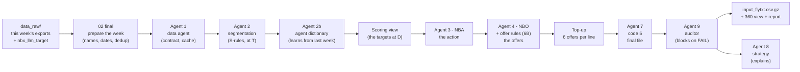

# NBX LLM: the next-best-action engine with LLM agents, explained

This document explains the project from end to end: **what it decides, how each agent works (with examples), and how
it differs from the old method based on the Vowpal Wabbit bandit (VW)**. It ends with the benefits of the new logic,
its limits, and how to measure that it works.

Contents

1. [What the project does](#1-what-the-project-does)
2. [The weekly run in one picture](#2-the-weekly-run-in-one-picture)
3. [The two dates: learn on T, decide on D](#3-the-two-dates-learn-on-t-decide-on-d)
4. [The golden rule: the rules decide what is allowed, the LLM chooses inside](#4-the-golden-rule-the-rules-decide-what-is-allowed-the-llm-chooses-inside)
5. [The agents one by one, with examples](#5-the-agents-one-by-one-with-examples)
6. [One customer from start to end](#6-one-customer-from-start-to-end)
7. [The old method (VW) and the new LLM logic, side by side](#7-the-old-method-vw-and-the-new-llm-logic-side-by-side)
8. [The benefits of the new logic](#8-the-benefits-of-the-new-logic)
9. [The limits, and how we handle them](#9-the-limits-and-how-we-handle-them)
10. [How to prove it works: what to measure](#10-how-to-prove-it-works-what-to-measure)
11. [The notebooks and the weekly routine](#11-the-notebooks-and-the-weekly-routine)
12. [Glossary](#12-glossary)

---

## 1. What the project does

Every week the campaign team sends offers to a list of prepaid customers (the **target**, here the file
`nbx_llm_target`). For **each customer** the engine decides:

1. **One action**: what we want the customer to do, one of 7 actions:

   | Action | Meaning |
   |---|---|
   | `RETAIN` | keep a customer who is at risk of leaving |
   | `MAINTAIN` | keep a stable, dual-usage customer on a similar spend |
   | `UPSELL` | move the customer to a bigger bundle |
   | `UPSELL DATA` / `UPSELL VOICE` | grow the data / voice spend of a customer who already uses it |
   | `CROSS SELL DATA` / `CROSS SELL VOICE` | sell data to a voice-only customer, voice to a data-only one |

2. **Six offers** that fit that action: 3 monthly (30 days, slots 1, 2, 5) and 3 weekly (7 days, slots 3, 4, 6),
   each with its SMS script in English and Arabic.

The result is one file, `input_flytxt.csv.gz` (38 columns, one row per customer), loaded into the campaign platform.

**What is new:** the action and the ranking of the offers are no longer produced by a statistical model alone (the VW
bandit and the BPR ranker of the old recipe). They are proposed by **LLM agents** (a language model running **on the
laptop GPU**, never in the cloud) that read the customer's facts and last week's results, **inside hard business
rules** that the code always enforces.

---

## 2. The weekly run in one picture



| Half | Steps | Data | Purpose |
|---|---|---|---|
| **Training** | agents 1, 2, 2b | the `*_auto` tables, anchored on **T** | learn from last week's campaign: who was targeted with which action, who bought |
| **Scoring** | scoring view, agents 3, 4, top-up | the `*_score` tables, anchored on **D** | decide this week's action and offers for each target customer |
| **Final** | agents 7, 9, 8 | the decisions | build the file, audit it, explain the result |

Measured on the real week of 2026-11-17: **1,721,440 lines** of the prepaid base used to learn, **112,559
purchases** in the reward window, about **30 minutes** for 25,000 target lines on one laptop GPU.

---

## 3. The two dates: learn on T, decide on D

| Date | Read from | Example | Used for |
|---|---|---|---|
| **T**, the campaign day | `date1` of `targeting_dataiku_auto` (one single campaign day) | 2026-11-04 | **training**: the customer as they were **before** last week's campaign (`*_auto` tables) |
| **D**, the last purchase day | the most recent purchase in `subs_btl_auto` | 2026-11-17 | **scoring**: the customer as they are **now** (`*_score` tables) |

- **Takers** (the reward) = the targeted customers who bought a catalogue offer **between T and D**.
- **Why two dates:** if we described the customer after the campaign, the model would "see" the purchase in its own
  inputs (for example a revenue jump) and learn nothing real.
- The dates are **never typed**: the notebook reads them from the data and **stops** when they do not hold (more
  than one campaign day, fewer than 95 % of the purchases between T and D, a training window going past T).

---

## 4. The golden rule: the rules decide what is allowed, the LLM chooses inside

| Who | Decides | Examples |
|---|---|---|
| **The code (rules)** | what is **allowed** and what **blocks** | the data contract, eligibility, the S-rules of the segments, the actions allowed per segment, the price band of the offers, the offer families of an action, conflicts, the audits |
| **The LLM** | the **best choice inside** what is allowed | which action for this customer, which offers first among the allowed ones, which action per segment cell |
| **The code again** | **checks** every LLM answer | an answer with the wrong shape is retried, then replaced by the rule answer; an action not allowed is impossible; the final file is blocked if an audit fails |

**Examples of hard rules the LLM can never break:**

- **H-06:** no upsell for an at-risk segment (`Retention_RGS_At_Risk` cannot get `UPSELL`, `UPSELL DATA`,
  `UPSELL VOICE`). On the real 50k run: 0 such lines. `Onboarding_Early_Churn_At_Risk` keeps `UPSELL`, its own
  production action.
- **Families (BR-66):** a `CROSS SELL DATA` customer gets VOICE or COMBO offers in the constraint universe; an
  `UPSELL` customer gets COMBO or DATA.
- **Price band:** recommended offers are priced from 1.0× to 1.5× the customer's usual spend (widened once to 2.0×),
  so the engine does not **downgrade** a customer.
- **Code 5 (the production final-file rules):** no offer twice (F-11), no two offers of the same type and price
  (F-09), no conflicting pair (F-12), scripts present.

**Privacy:** the LLM runs on `127.0.0.1` only; prompts hold segment names and rounded figures, **never an MSISDN**.

---

## 5. The agents one by one, with examples

| # | Agent | Kind | What it does | Can it change a decision? |
|---|---|---|---|---|
| ① | Data agent | rules + LLM explains | checks every table against the contract, builds the cache | no: the rules block, the LLM explains |
| ② | Segmentation | rules + LLM explains | features of the whole base, S-rules → segment, bands | no |
| ②b | **Agent dictionary** | **LLM decides, code validates** | the best action per segment cell, learnt from last week's rewards | **yes** (the cell policy) |
| ③ | **NBA (next best action)** | **LLM decides, code validates** | the action of each customer | **yes** |
| ④ | **NBO (next best offer)** | **LLM scores, rules choose** | scores the allowed offers | **yes** (the ranking) |
| ⑥B | Offer rules (challenger) | rules | allowed offers, price band, the passes, 6 offers | (rules) |
| ⑦ | Final output (code 5) | rules | the 38-column file, favourites, scripts | (rules) |
| ⑨ | Auditor | rules + LLM explains | blocks the file on any FAIL | no: the rules win |
| ⑧ | Strategy | LLM explains | compares groups and the agents against the cell policy | no: a proposal |

### ① Data agent: is this week's data usable?

- **Rules:** every table is checked: columns, types, keys, ranges, dates, completeness. A **blocking** issue stops
  the run (for example: 60 campaign lines whose ID is not in the base).
- **LLM:** reads the report and explains it in plain words: *"The data is usable. 2 warnings: the consent table is
  missing (nobody is excluded for consent) and 3 % of the lines have no age (the age band is 'unknown')."*

### ② Segmentation: who is this customer?

The S-rules give each line one segment, first match wins (14 rules). Examples:

| Customer facts | Segment | Rule action |
|---|---|---|
| tenure 60 days, churn 0.7 | Onboarding_Early_Churn_At_Risk | UPSELL |
| revenue-generating, churn 0.55 | Retention_RGS_At_Risk | RETAIN |
| revenue M1 down 35 % vs M2 | Retention_RGS_Fragile | UPSELL |
| voice and data user, stable | RGS_Not_At_Risk_DualPlay_Upgrade | MAINTAIN |
| voice only, data appetency 0.7 | Voice_Only_Data_Appetency | UPSELL DATA |

Each line also gets its value band (low / mid / high spend), usage type (voice only, data only, dual) and **last
week's facts**: targeted or not, with which action, and whether it bought (the reward).

### ②b Agent dictionary: learn from last week, per segment cell

**The question:** for each **cell** (segment × nationality group), which action works best?

**What the LLM sees (example, simplified):**

```
Cell: Retention_RGS_Fragile / India — 4,210 lines, average ARPU 6.8, 71% voice users, 24% data users.
Current action: UPSELL.
Last week, take rate per action sent in this cell:
  UPSELL 3.1% of 1,900 | UPSELL DATA 6.4% of 640 | RETAIN 4.0% of 410 | MAINTAIN 2.2% of 300
Allowed actions: UPSELL, UPSELL DATA, RETAIN, MAINTAIN, CROSS SELL VOICE, UPSELL VOICE, CROSS SELL DATA.
Rank the best 1 or 2 actions, with a reason.
```

**What it answers (JSON, checked by the code):**

```json
{"ranking": ["UPSELL DATA", "RETAIN"],
 "reason": "Voice users in decline: UPSELL DATA doubled the take rate of UPSELL on 640 lines; RETAIN second."}
```

**The code then checks** (`validate_agent_dictionary`): the action exists, the segment is not excluded, **no upsell
first for an at-risk segment (H-06)**. A refused cell keeps its current action. The new dictionary is **versioned**
(`dict_segm_actions_agent_v<N>.json`) and next week starts from it: **the system learns week after week**.

The action of the cell is the **cell policy**: the fallback of agent 3.

### ③ NBA: the action of each customer

**Fast mode:** customers whose rounded facts are identical form a **profile** and share one LLM answer (on the real
25k run, level `minimal`). The action is still **drawn per customer**.

**What the LLM sees (example profile, simplified):**

```
Customer: segment Retention_RGS_Fragile, value band mid, usage voice_only, revenue M1 4.80-7.20 (trend down),
churn 0.3-0.7, last week: targeted with UPSELL, no offer taken.
Cell policy: UPSELL DATA.
Allowed actions, in order: [CROSS SELL DATA, UPSELL DATA, RETAIN, MAINTAIN, UPSELL, CROSS SELL VOICE, UPSELL VOICE]
Return one score per allowed action, in that order, and a short reason.
```

**What it answers:**

```json
{"scores": [10, 70, 45, 20, 15, 30, 5],
 "reason": "Declining voice spender who ignored UPSELL: adding data (UPSELL DATA) is a smaller, likelier step."}
```

**The draw** (exploration, as in the VW bandit): p(action) = 0.9 × score / Σ scores + 0.1 / 7.

| Action | Score | p(action) |
|---|---|---|
| UPSELL DATA | 70 | 0.9 × 70/195 + 0.014 = **0.337** |
| RETAIN | 45 | 0.222 |
| CROSS SELL VOICE | 30 | 0.153 |
| MAINTAIN | 20 | 0.107 |
| UPSELL | 15 | 0.084 |
| CROSS SELL DATA | 10 | 0.060 |
| UPSELL VOICE | 5 | 0.037 |

Each customer draws with their own seed. Most get `UPSELL DATA`; some get another action (**exploration**), and the
**probability of the action sent is logged** (`PROPENSITY_LOGGED`). Next week this lets us measure, without bias,
which action really works better: the same idea as VW, but each choice now comes **with a reason**.

`DECIDED_BY` says who decided: `llm_nba` (the top action), `llm_nba_sampled` (an explored action) or
`fallback_cell_policy` (the LLM failed after 6 retries; the final report counts them, and their share must be 0).

### ④ NBO: score the offers the rules allow

**First the rules (CPU):** for this customer and this action, the **allowed offers** = the action's families (for
UPSELL DATA: VOICE and COMBO, BR-66), in the
catalogue, near the customer's price level. Each gets a **rule score** (the customer's own past purchases first,
then the offer's popularity). The best 4 per validity make the short list.

**Then the LLM (one answer per profile × action):**

```
Customer: segment Retention_RGS_Fragile, value band mid, usage voice_only, revenue M1 4.80-7.20 (trend down) ...
Action: UPSELL DATA.
Offers (all in the customer's price band, best first by the rules):
  0: VOICE L2, 30 days, price 5.00, - GB, 500 min
  1: COMBO L2, 30 days, price 5.00, 14.0 GB, 360 min
  2: COMBO L2, 30 days, price 7.00, 20.0 GB, 480 min
  3: VOICE L2, 30 days, price 6.00, - GB, 650 min
  4: COMBO L2, 7 days, price 3.00, 9.0 GB, 180 min ...
Return one score per offer, in order.
```

```json
{"scores": [35, 80, 60, 25, 70, 40, 30, 20]}
```

**Then the passes choose (CPU), per customer:** expected value = score × price, the best per type inside the price
band (1.0× to 1.5× the usual spend), widened once to 2.0×, then the production passes as a fallback, and a third offer
per validity (6 offers).

### Top-up: always 6 offers

Some lines end with fewer than 6 offers (a conflict cleared a slot, nothing fits the price band). The top-up fills
each empty slot, in order: the customer's short list → the same action's offers → their favourites → the segment's
other allowed actions. Every added offer must be in the catalogue, have both scripts and not conflict. The auditor
(A-25) **blocks the file** unless every line has 6 distinct valid offers.

On the real 50k run: **48,347 lines × 6 offers**; 99.2 % of the offers come from the recommendation, 0.6 % from the
top-up, 0.15 % are favourites.

### ⑦ Code 5, ⑨ auditor, ⑧ strategy

- **⑦ Code 5** (the production rules F-01 … F-19): slots by price (highest first), favourites into empty slots,
  F-09 / F-11 / F-12, scripts, the 38 columns.
- **⑨ Auditor:** A-12 … A-31 and A-25. Any FAIL = **no file**. The LLM explains the result; if it disagrees, the
  rules win.
- **⑧ Strategy:** the LLM compares the groups and the agents' decisions against the cell policy, and lists 3 things to
  watch next week. A proposal only: the truth is next week's reward.

---

## 6. One customer from start to end

| Step | What happens to customer *C* (fictional) |
|---|---|
| Data | C is in `nbx_llm_target`; their tables pass the contract |
| ② at T | voice user, revenue M1 6.10 vs M2 9.80 (−38 %) → **Retention_RGS_Fragile**; last week: targeted with UPSELL, **no purchase** |
| ②b | the cell Fragile / India learnt that UPSELL DATA works better (6.4 % vs 3.1 %) → cell policy **UPSELL DATA** |
| Scoring view at D | C is still Fragile, value band mid, revenue down |
| ③ NBA | profile scores: UPSELL DATA 70, RETAIN 45, … → C draws **UPSELL DATA** (p = 0.337, logged) |
| ④ NBO + rules | allowed: VOICE / COMBO offers (the families of UPSELL DATA) near 6 R; the LLM prefers the 5 R combo (14 GB + 360 min) and the 3 R weekly combo |
| Passes + EXT-6 | monthly: 7 R, 6 R, 5 R; weekly: 4 R, 3 R, 2 R (all ≥ C's usual spend) |
| Code 5 | slots 1-2-5 monthly by price, 3-4-6 weekly; scripts EN / AR; `segment` = UPSELL DATA |
| Auditor | 6 distinct valid offers, no conflict → **PASS** |
| Next week | if C buys between T' and D', `W0_REWARD = 1` for UPSELL DATA in their cell: ②b and ③ learn from it |

---

## 7. The old method (VW) and the new LLM logic, side by side

**The old method** (the production recipe, "codes 1 to 5"):

1. **Code 1:** a fixed dictionary segment → action (`dict_segm_actions`; written by hand, with repeated keys where the
   last value wins).
2. **NBA model: Vowpal Wabbit** contextual bandit (`--cb_explore_adf -q UA --epsilon 0.2`), trained on last week's
   targeted lines (61 numeric + 2 categorical features; cost = −reward), then **sampled** per customer.
3. **Codes 3 / 4:** offers ranked by a **BPR** recommender trained on the 270-day purchase history, then chosen by
   **price-band passes** (anchor < price < anchor + 2 or 3), at most 4 offers.
4. **Code 5:** the final file.

| Topic | Old method (VW + BPR + rules) | New logic (LLM agents + rules) |
|---|---|---|
| **Action per segment** | fixed dictionary, changed by hand | **agent 2b** re-ranks the action of each cell **every week** from the take rate per action, validated by the code, versioned |
| **Action per customer** | VW: a probability per action from 61 numeric features | **agent 3**: a score per allowed action from the customer's facts **and** last week's outcome, then the same kind of draw |
| **Why this action?** | no explanation: a probability vector | **a written reason** per decision, stored in the 360 view |
| **Learning signal** | needs **logged propensities**; the legacy weeks had propensity 1.0 (one action per segment), so they are not usable for off-policy learning | every LLM decision **logs its propensity** from the first week: uplift measurable at once |
| **Little data** (new segment, small cell) | the bandit has too few takers to learn | the LLM reasons from the facts and the evidence it gets, even with few lines |
| **Exploration** | ε = 0.2 (random) | ε = 0.1 (random) on top of a **reasoned** ranking |
| **Business rules** | partly inside the model (it can learn an upsell for an at-risk customer) | **outside the model, hard**: H-06, families, price band, consent; the LLM only sees the allowed choices |
| **Offer ranking** | BPR on past purchases: **an offer never bought is invisible** (cold start) | rule score + **LLM score** from the offer's attributes (service, GB, minutes, price): a new offer is scored at once |
| **Offers per line** | up to 4 (often fewer) | **always 6** (3 monthly + 3 weekly), audited (A-25) |
| **Downgrade** | price above the anchor | price band 1.0× – 1.5× the usual spend, plus the ARPU check of notebook 05 |
| **When the model fails** | no valid model (or older than 14 days) = no scoring | each answer is retried 6 times; on failure the **rule answer** is used and counted in the final report |
| **Model management** | registry, promotion test, drift, retraining | no model to train: a local LLM, a versioned dictionary, a cache of answers |
| **Change a strategy** | change features, retrain, re-validate | change a rule or a prompt; the effect is visible the same week |
| **Compute** | CPU, minutes | CPU for the data + GPU for the agents: **~30 min for 25k** targets on one laptop GPU |
| **Audit trail** | the scored action | the 360 view: segment at T and D, cell policy, LLM scores and reason, propensity, who decided, each slot's reason and price vs spend |
| **Privacy** | local | local: the LLM runs on the laptop, no MSISDN in any prompt |

---

## 8. The benefits of the new logic

1. **It learns every week, per segment.** Agent 2b reads last week's take rate per action in each cell and moves the
   cell to the action that works. The old dictionary stayed the same until someone edited it.
2. **Every decision is explained.** "Declining voice spender who ignored UPSELL: adding data is a likelier step." The
   business can read, challenge and validate the logic. A VW probability cannot be explained this way.
3. **It uses what happened last week, per customer.** The prompt says "targeted with UPSELL, no offer taken": the
   agent does not repeat an action that just failed, unless the evidence says so.
4. **It works with little data.** A small cell or a new segment still gets a reasoned action. The bandit needs
   enough logged takers per action to learn.
5. **New offers are usable at once.** Agent 4 scores an offer from its attributes; the BPR ranker cannot rank an
   offer nobody has bought yet.
6. **The business rules are guaranteed.** They are applied by the code around the LLM, not learnt by a model: no
   upsell to an at-risk segment, offers in the action's family, no downgrade below the usual spend, no conflicts.
7. **Uplift stays measurable.** The exploration draw and the logged propensity keep the experiment clean, from the
   first week.
8. **A fuller, cleaner file.** 6 valid offers per line (vs up to 4), always in the catalogue, with both scripts, no
   repeated offer, audited before it is written.
9. **Robust and fast to change.** Retries, Ollama restart, cache and resume; a rule or a prompt changes the strategy
   without retraining a model.
10. **Full transparency for checks.** Notebook 05 checks every rule on the final file (catalogue, scripts, F-09 / F-11
    / F-12, validity per slot, favourites, same price with a different allocation, dominated offers, ARPU, H-06,
    families) and gives a scorecard.

---

## 9. The limits, and how we handle them

| Limit | How it is handled |
|---|---|
| The LLM can be wrong or vague | it only chooses among allowed options; every answer is schema-checked; the rules and the auditor have the last word |
| Fast mode groups customers into profiles, which loses detail | the quality check asks 100 customers with their exact facts and warns under 70 % agreement; `PROFILE_LEVEL` can be set finer (`coarse`, `fine`) at the cost of GPU time |
| Almost flat scores (the LLM does not separate the actions) | the final report warns when more than half the profiles are almost flat |
| GPU time grows with the target size | fast mode, cache across weeks, 8 requests in parallel; 25k targets took ~30 minutes |
| A benefit is a hypothesis until it is measured | the reward at D+7 is read by next week's run; compare with a control group or the production target (section 10) |
| Top-up and favourites can be cheaper than the usual spend | flagged in the 360 view (`CHK_*_BELOW_ANCHOR`) and in notebook 05 part 8b (ARPU per service) |

---

## 10. How to prove it works: what to measure

The real test is **next week's purchases** of this week's targets (the reward, read by the next run).

| KPI | How | Expected if the LLM logic helps |
|---|---|---|
| **Take rate** | targeted customers who bought a catalogue offer between T and D, per action and per group | higher than the production target (VW / Target 1) or a control group |
| **Uplift** | take rate of the targets − take rate of a **control group** (not contacted) | positive, and higher than the old method's |
| **Revenue per targeted customer** | BTL revenue in the window | higher, **without** a drop in base ARPU (no downgrade) |
| **Explored vs top action** | the take rate of `llm_nba` vs `llm_nba_sampled`, weighted by the logged propensity | the top action beats the explored ones; if not, the agent is told so next week through the evidence |
| **Cell policy vs agent** | customers decided by the agent vs those with the cell policy | the agent at least as good |
| **No downgrade** | notebook 05, part 8b: offers below the customer's spend | 0 for the recommended offers |

To compare fairly, keep a **control group** (`CONTROL_SIZE`) or run the old method on a comparable sample the same
week.

---

## 11. The notebooks and the weekly routine

| Notebook | What it does |
|---|---|
| `02_prepare_week_final` | reads `data_raw/` (the exports + `nbx_llm_target`), checks the files are this week's, writes `data/weekly/<D>/` |
| `04_nbx_llm_final` | the weekly run: every line of `nbx_llm_target`, constraint logic, whole base to learn, no LLM stop; outputs in `data/nbx_llm/` |
| `05_check_flytxt_results` | every check of the final file and the 360 view, with the scorecard |
| `04_agents_nba_fast_ollama_real25k` | the same engine for tests on a sample (`--size 1000`, …), outputs in `data/real25k/` |

**Every week:**

1. Copy this week's exports **and** `nbx_llm_target.csv.gz` into `data\data_raw\` (remove last week's files).
2. Run `02_prepare_week_final` (Restart & Run All).
3. Run `python notebooks3\run_notebook04.py --final` (headless, no timeout).
4. Run `05_check_flytxt_results` and read the scorecard.
5. Load `data\nbx_llm\output\<D>\final\input_flytxt.csv.gz` into the campaign platform.

---

## 12. Glossary

| Term | Meaning |
|---|---|
| **Action** | one of the 7 marketing goals (RETAIN, MAINTAIN, UPSELL, UPSELL DATA / VOICE, CROSS SELL DATA / VOICE) |
| **Agent** | a step where an LLM decides or explains; the code validates its answer |
| **Cell** | segment × nationality group: the unit of the agent dictionary |
| **Cell policy** | the action of the cell (agent 2b); the fallback of agent 3 |
| **Constraint universe (group a, T2C)** | offers restricted to the action's families (CC rules); the logic of the final run |
| **D / T** | the scoring date (last purchase day) / the campaign day (training) |
| **ε (epsilon)** | the share of random exploration in the action draw (0.1) |
| **Fast mode / profile** | customers with the same rounded facts share one LLM answer |
| **H-06** | no upsell for an at-risk segment |
| **Propensity** | the probability the policy gave to the action sent; logged to measure uplift without bias |
| **Reward / taker** | a targeted customer who bought a catalogue offer between T and D |
| **S-rules** | the 14 ordered rules that give each line its segment |
| **Usual spend (anchor, ARPU)** | the customer's average spend per week / month; the price band is built on it |
| **VW** | Vowpal Wabbit, the contextual bandit of the old method |
